# ShipFlow — Technical Documentation

*CLI-First, Self-Hosted CI/CD and Release Automation Platform*

> **How to read this document.** Every statement is tagged by how it is known:
> **[verified]** = confirmed in the source code, database or a test run during preparation of this document;
> **[tested]** = exercised by an automated test; **[reported]** = stated by the project owner but not re-checked here;
> **[inferred]** = follows from the code or from documented behaviour of a tool, but was not run;
> **[future]** = proposed work that does not exist yet.
> Code references use repository-relative paths. `<SHIPFLOW_API_TOKEN>`-style placeholders replace all secrets.
> `http://localhost:8081/` is a **local demo address**, not a public URL. ShipFlow is **not** deployed on any public server.

## 1. Executive Summary

### 1.1 What ShipFlow is, in plain language

Imagine you have a website in a Git repository. Every time you change it, somebody has to download the code, install its libraries, build the final HTML/CSS/JavaScript files, run the tests, copy the result to a server, check that the site still opens, and — if the new version is broken — put the old version back. Doing this by hand is slow and error-prone.

**ShipFlow automates exactly that.** You type one command:

```bash
shipflow deploy https://github.com/<you>/<your-static-site>
```

and ShipFlow clones the repository, builds and tests it inside a locked-down temporary container, stores the result in S3 under a version-stamped location, checks it over HTTP, and only then switches the live website to the new version. If anything fails before the switch, the live site is untouched. If a version turns out to be bad later, `shipflow rollback <releaseId>` makes an earlier good version live again.

### 1.2 Who it is for

ShipFlow targets a **single owner or small trusted team** that wants a self-hosted release pipeline for **static sites** (anything whose build writes `dist/`, `build/` or `out/`, such as Vite or Create-React-App projects). It is a portfolio-grade engineering project: it demonstrates how CI/CD systems are built rather than trying to replace the commercial ones (Chapter 12).

### 1.3 The architecture in one paragraph

A **CLI** talks to an **Express API** using a bearer token. The API validates the request, records a release row in **PostgreSQL**, and puts a job on a **Redis/BullMQ** queue so the HTTP request returns immediately. A separate **worker** process takes the job and runs the pipeline **PREPARE → BUILD → TEST → DEPLOY → VERIFY → ACTIVATE**. Repository-controlled commands (dependency install, build, test) run in a throw-away **Docker sandbox container** with no secrets. The build output is validated and uploaded to an **immutable, versioned S3 prefix** (`releases/<id>/build/`). A release becomes live only when a single row is inserted into an `activations` table; a small **site server** then streams the active release's files from S3.

### 1.4 Strongest engineering contributions

1. **Asynchronous, queue-based execution** with durable release state, stage logs and notifications (Chapters 4–7).
2. **Defence in depth for untrusted build code**: environment never inherited, disposable non-root container with dropped capabilities and resource limits, network removed before build/test, symlink-safe uploads (Chapter 9).
3. **Safe release semantics**: immutable artifacts, validation before upload, HTTP verification of the *candidate* before it is live, pointer-based activation instead of delete-and-copy, manual rollback that reuses stored artifacts (Chapters 6 and 8).
4. **Evidence**: 51 unit tests and a 13-scenario Docker end-to-end suite that includes a probe trying to steal secrets from inside a build (Chapter 10).

### 1.5 Current maturity and limitations

ShipFlow is a **verified local demo**, not a production service. The 51 unit tests and 13 e2e scenarios pass on the current checkout (Chapter 10), and a real repository has been built, uploaded to a real S3 bucket and served at `http://localhost:8081/` (local only). Important limitations (detailed in Chapters 9 and 16): the worker holds the Docker socket; one shared API token, no user accounts; the sandbox has internet during dependency install and — verified during this documentation work — can still reach host ports that are published on all interfaces through the Docker bridge gateway; one global live site per installation (no project concept); not deployed to any public server; not safe for arbitrary public users.

## 2. How ShipFlow Started

This chapter is reconstructed from the Git history (16 commits between 2026-06-19 and 2026-09-12) and the code at commit `3709133`, the last commit before the hardening work.

### 2.1 Timeline

| Date | Commit | What was built |
|---|---|---|
| 2026-06-19 | `932f8a7`, `bee49ee` | Empty project (`package.json`) and a README describing an upload / deployment / request-handler design (the shape of a Vercel-style clone). |
| 2026-06-20/22 | `aa9e723` … `218274a` | `POST /deploy` that **cloned the repository inside the HTTP request**, uploaded every file to S3 with the local path as the key, and enqueued `{ id }` on a BullMQ queue. Random ID generator. |
| 2026-08-23 | `33a4fc1`, `aa65059` | A BullMQ **worker** (initially a stub that only logged), Redis settings from environment variables, `Dockerfile`, `docker-compose.yml`, PostgreSQL connection and `releaseStore.js`. |
| 2026-08-24/25 | `78ecb2a`, `00ab0e8`, `7273e65` | `prepare`, `build`, `test`, `deploy`, `verify`, `notify` stages; `rollback`; `active/` prefix in S3. Pipeline orchestrated inside `worker.js`. |
| 2026-09-07 | `62f16b5` | First CLI (`deploy`, `status`) and `src/pipeline.js`; stages moved out of `worker.js`. |
| 2026-09-12 | `3709133` | `releases` and `logs` CLI commands; `release_logs` table access (`src/logStore.js`). |

Two facts matter for interviews. First, the *design* (API → queue → worker → pipeline → S3) was sound from the start; the weaknesses were in the details. Second, **no SQL schema file ever existed in the repository** — a search of the full history for `CREATE TABLE` finds nothing outside `node_modules` **[verified]** — so a fresh clone could not create its own database.

### 2.2 The original design and its limitations

| Area | Original design (commit `3709133`) | Original limitation (verified in that code) |
|---|---|---|
| API | Express `index.js` with `cors()` enabled; `POST /deploy`, `GET /releases`, `/releases/:id`, `/releases/:id/logs`, `POST /rollback/:id`, `GET /active/*`. | **No authentication**: anyone who could reach port 8000 could deploy or roll back. Only `repoUrl` presence was checked (any URL, including non-GitHub). `GET /deployments/:releaseId` joined an unvalidated path segment into `path.join(cwd, "output", releaseId, ...)`. Unknown-release logs returned an empty list, not 404. |
| Worker and queue | BullMQ queue `deployment-queue`; `worker.js` consumed jobs and ran stages sequentially (later `src/pipeline.js`). | No cap on queued builds, no concurrency setting, no job ID; the cloned workspace in `output/<id>` was never deleted ("Do NOT delete workspace here" comment). |
| Build/test execution | `execFile("npm"/"pnpm"/"yarn", …)` on the **worker itself**. `build.js` passed no `env` option, so Node's default applied: **the child inherited the worker's full environment**. `test.js` explicitly spread `...process.env`. | Repository scripts could read AWS keys, DB password, Redis settings. The compose file mounted the whole project (`.:/app`, including `.env`) into the same container the scripts ran in. `execFile`'s default 1 MB `maxBuffer` meant verbose builds could fail with a buffer error; no timeouts; output of *successful* steps was never persisted (the pipeline wrote only generic "Build completed" lines) and on failure only `error.message` was stored. |
| Artifact storage | Source files uploaded as `<releaseId>/<path>`; build output uploaded to `releases/<id>/build/`. | `getAllFiles` used `fs.statSync`, which **follows symlinks**: a repository could contain a symlink to a worker file and have it uploaded. Upload did not validate that the build contained `index.html` or its assets. |
| Deployment activation | `deployRelease` uploaded the build, then `activateRelease` ran `deleteS3Prefix("active/")` **and then** copied every object from `releases/<id>/build/` to `active/`. | The live site was **empty (or partial) for the duration of the copy**; a failure half-way left a broken site. Verification ran *after* activation (status 200–399 on `http://api:8000/active/`), so a bad release was already live when it was checked. |
| Rollback | `POST /rollback/:releaseId` called `getPreviousSuccessfulRelease(currentReleaseId)`. | The argument was treated as the *current* release and the newest *other* SUCCESS release was chosen — the user could not pick a target. It also deleted `active/` first and copied after, with the same empty-window risk. The CLI had no `rollback` command although the README ticked "Rollback ✅". |
| Security | Secrets from `.env` via `env_file`; the committed compose file published PostgreSQL (5432) and Redis (6379) to the host and contained a hard-coded database password (the port mappings had already been removed in the working tree by a manual edit before this pass). | Database and queue exposed on host ports; a database password committed to version control; `node_modules` (6,638 files) and an embedded repository (`output/peBQy5bb`) tracked in Git. |
| Logging and testing | `release_logs` and `notifications` rows written by the pipeline. | No automated tests, no CI workflow, no schema/migration, `package.json` `build` script pointed at a nonexistent `build.js`. CLI `logs` error path called `body.text()` before `body` was initialised (a `ReferenceError`). |

### 2.3 Three kinds of problems (do not confuse them)

* **Design weaknesses** present from the beginning: unauthenticated API, inherited environment, delete-then-copy activation, post-activation verification, workspace never cleaned.
* **Plain bugs**: the CLI `logs` error handler, `scripts.build`, rollback not honouring the chosen target, symlink following, unbounded `Math.random` ID alphabet (the original alphabet string repeated characters; IDs were generated with `Math.random`, which is not cryptographically secure).
* **Breakage from later, incomplete manual edits** (uncommitted work at the start of this engineering pass): `src/test.js` imported `./buildEnv` **without the `.js` extension** (invalid in ES modules, so `worker.js` crashed on import), `worker.js` had lost its stage imports in the working tree, and `src/buildEnv.js` was untracked and not yet used by `build.js`. These came from a half-finished attempt to stop leaking the environment, not from the original design.

## 3. Technology Stack: What and Why

| Technology | Role in ShipFlow | Why it was chosen | Alternative |
|---|---|---|---|
| Node.js 22, ES modules (`"type": "module"`) | Runtime for CLI, API, worker, tests. Uses built-ins: `fetch`, `node:test`, `crypto`, `child_process`. | One language for every component; first-class async I/O suits a system that mostly waits on git, S3 and containers; `fetch`/`node:test` remove the need for HTTP-client and test-framework dependencies. | Go (single static binary), Python. |
| Express 5 | HTTP API (`src/app.js`) and the site server. | Minimal, well known, easy to unit-test by injecting dependencies (`createApiApp(deps)`). Express 5 handles async route errors natively. | Fastify, Hono. |
| PostgreSQL 17 + `pg` | Durable state: releases, logs, notifications, activation history. | Releases are relational and must survive restarts; transactions and advisory locks give safe activation; SQL makes "which release is live?" a one-line query. | SQLite (simpler, single-writer), DynamoDB. |
| Redis 7 + BullMQ + `ioredis` | Job queue between API and worker. | Builds take minutes; an HTTP request must not wait. BullMQ adds persistence, job state, concurrency control and stalled-job handling on top of Redis. | RabbitMQ, SQS, a Postgres-backed queue. |
| Docker + Docker Compose | Runs the stack (API, worker, Postgres, Redis) and, through the Docker daemon, the **build sandbox containers**. | Containers give a cheap, scriptable isolation boundary and reproducible environments; Compose describes the whole stack, health checks and start-up order in one file. | VMs or Firecracker micro-VMs (stronger isolation, much more work), gVisor, rootless Podman. |
| AWS S3 + `@aws-sdk/client-s3` | Immutable artifact storage (`releases/<id>/source/`, `releases/<id>/build/`). | Cheap, durable object storage; versioned key prefixes make every release permanent and independently addressable. The SDK also works against S3-compatible mocks (used by the e2e suite). | Local disk, MinIO, Cloudflare R2. |
| Git + GitHub | Source of truth for the code being deployed; ShipFlow only *clones* (shallow, anonymous). | Universal; no credentials are needed for public repositories. | GitLab, local paths. |
| npm, pnpm, Yarn (via Corepack) | Package managers detected from `packageManager` or lockfile (`src/packageManager.js`). | Real projects use all three; lockfile-based installs make builds reproducible. | Support npm only. |
| `node:test` runner | 51 unit tests (`test/unit`) and 13 e2e scenarios (`test/e2e`). | No test-framework dependency; parallel by default; TAP output works in CI. | Jest, Vitest. |
| GitHub Actions | `.github/workflows/ci.yml` runs the unit suite, compose validation and the e2e suite. | Free for public repositories and native to GitHub. **[verified]** the workflow file exists; **[NOT RUN]** it has never executed because nothing has been pushed. | GitLab CI, Jenkins. |
| The CLI (`cli/index.js`, `cli/deploy.js`) | Thin HTTP client using built-in `fetch`; configured by `SHIPFLOW_API_URL` and `SHIPFLOW_API_TOKEN`. | Fast to demo and script; no UI to maintain. | Web dashboard, GitHub App. |

**Why the queue matters (plain explanation).** If `POST /deploy` ran the whole build, the HTTP request would hang for minutes, time out behind proxies, and die if the API restarted. With BullMQ the API only writes a row and a job and answers `202 Accepted` in milliseconds; the CLI then **polls** `GET /releases/:id`. The worker can be restarted independently, and a crashed job can be detected.

**Why PostgreSQL *and* Redis.** They answer different questions. Redis/BullMQ answers "what work is waiting right now?" — ephemeral, fast. PostgreSQL answers "what happened, and what is live?" — durable and queryable. If Redis were wiped, queued jobs would be lost but history and the live pointer would remain.

**Why S3 for artifacts.** An artifact stored once at `releases/<id>/build/` never changes. That immutability is what makes rollback trivial (point back at an old prefix) and makes verification meaningful (you verify exactly the bytes that will go live).

**Why Docker for builds.** `npm install` runs arbitrary `postinstall` scripts from every transitive dependency, and `npm run build` runs whatever the repository author wrote. Running that on the worker would give strangers the worker's secrets and filesystem. A throw-away container with no secrets, no host mounts and limited resources shrinks that blast radius (it does not remove it — see Chapter 9).

## 4. High-Level Design (HLD)

### 4.1 System context

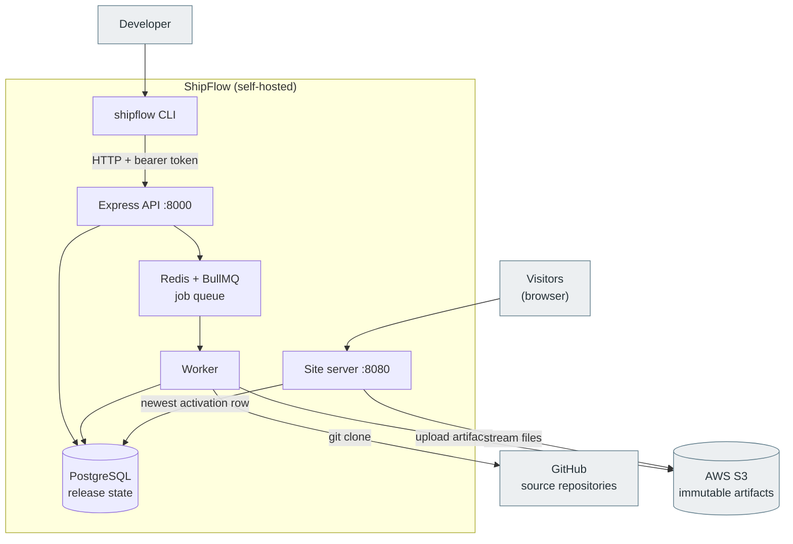

**What it shows.** The grey boxes are external systems ShipFlow depends on but does not control (GitHub, S3, and the people on either end). Everything inside the "ShipFlow" box runs on your own machine. Note that *visitors never talk to the API* — they hit a separate **site server** on port 8080, which reads the live pointer from PostgreSQL and streams files from S3. In the current checkout the API and the site server are two HTTP listeners in the **same Node process** (`index.js`) **[verified]**.

### 4.2 High-level architecture and release flow

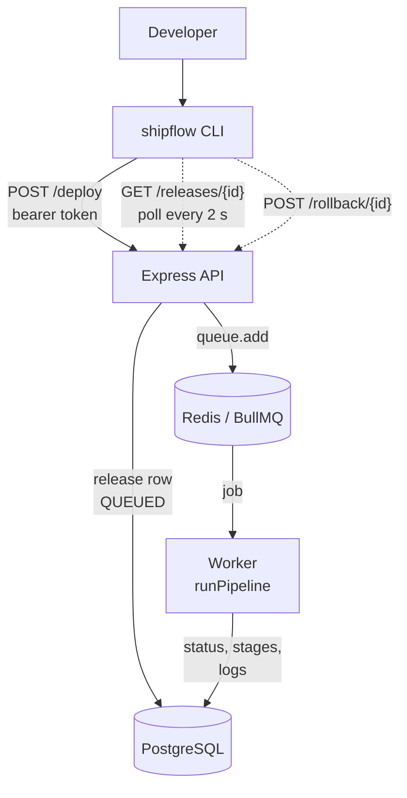

**What it shows.** The synchronous half of a release. `POST /deploy` only validates, writes one `releases` row and one queue job, then returns `202`; the CLI then polls the API for status. All the slow work happens in the worker, which reports progress by updating the same `releases` row and writing `release_logs` and `notifications` rows. Manual **rollback** enters through the API too (dotted arrow) and is covered in Diagram F.

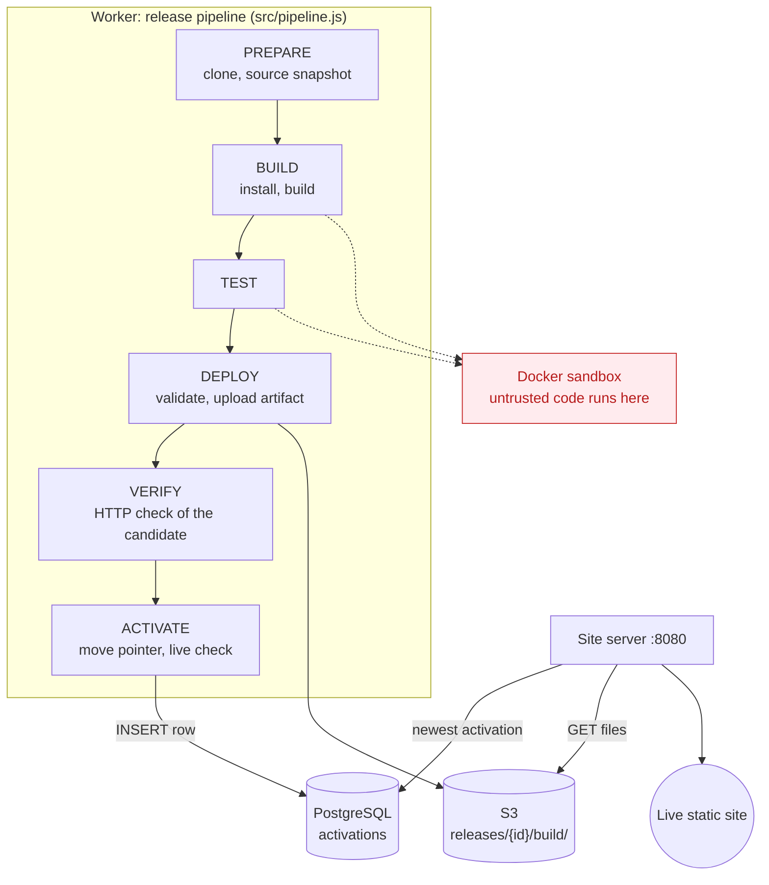

**What it shows.** The six pipeline stages in `src/pipeline.js` and what each touches **[verified]**. Only BUILD and TEST use the sandbox (red). DEPLOY writes to S3 but changes nothing visitors can see; ACTIVATE is the only stage that changes what the site server returns. The site server (right) is independent of the pipeline: it reads the newest `activations` row and streams that release's files from S3.

### 4.3 Docker deployment and trust boundaries

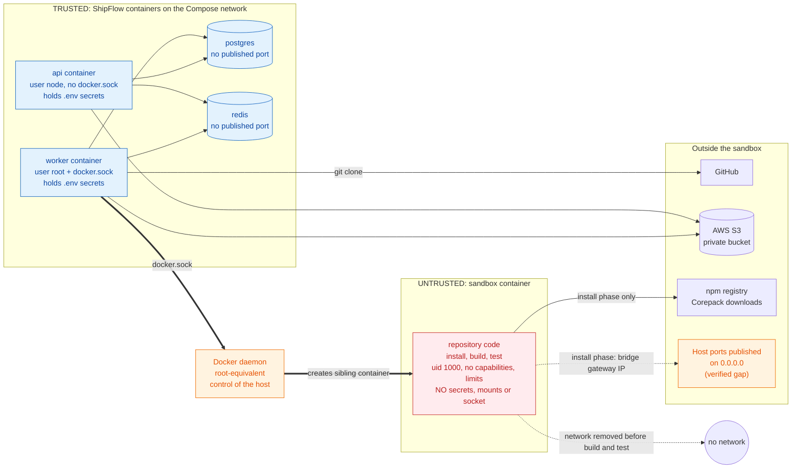

**What it shows.** Blue containers are trusted ShipFlow code, the red container runs repository code, and orange marks the two exposures discussed below: the Docker socket and host-published ports.

**What this diagram does and does not claim.**

* **Trusted vs untrusted.** The blue containers run ShipFlow's own code. The red container runs code from the repository being deployed. The sandbox is a **sibling** container created through the host's Docker daemon, not a process inside the worker, and it is *not* attached to the Compose network, so service names such as `postgres`, `redis` and `api` are not reachable from inside it **[tested]** (the e2e probe tries them in every phase).
* **Secrets stay outside the boundary.** `.env` values reach the `api` and `worker` containers through `env_file`; the sandbox is created with only `CI`, `HOME`, `COREPACK_ENABLE_DOWNLOAD_PROMPT` and `npm_config_update_notifier` **[verified]** in `src/sandbox.js`. Source goes *in* and `dist/` comes *out* with `docker cp`, so no host directory is ever bind-mounted into it.
* **Network.** During dependency install the sandbox is on Docker's default bridge network and can reach the internet. Before the build and test commands run, `docker network disconnect bridge` removes the network entirely **[tested]**: the e2e probe asserts internet is reachable during install and not during build.
* **The worker's Docker socket is the biggest residual risk.** Access to `/var/run/docker.sock` is effectively root on the host. Only ShipFlow's own worker code uses it, but if the worker were compromised (for example through a bug in how it handles repository output), the attacker would control the host. The orange boxes mark this and one more gap found while preparing this document: the install-phase network can reach **host ports published on all interfaces** through the bridge gateway (`172.17.0.1` here). The `--add-host host.docker.internal:127.0.0.1` line in `src/sandbox.js` blocks the *name* `host.docker.internal`, but a direct connection to the gateway IP reached a Postgres published on `0.0.0.0:5432` on this machine, while ShipFlow's own API and site ports (bound to `127.0.0.1`) were refused **[verified]** by a manual test run on 2026-10-10. See Chapter 9.

### 4.4 Data and storage architecture

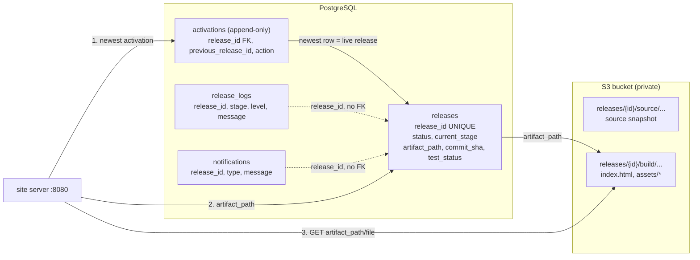

**What it shows.** Four tables and two S3 prefixes per release. `releases` is the registry; `artifact_path` links a row to the immutable files in S3. The **live site is not a flag on `releases`**: it is "the newest row of `activations`". Because artifacts never change after upload, switching the live release only needs one new row — there is no copy step that could leave the site half-updated. Logs and notifications refer to a release by ID but the schema does **not** enforce that with a foreign key (Chapter 7).

## 5. Low-Level Design (LLD)

### 5.1 Execution entry points

There are four entry points **[verified]**:

* `cli/index.js` — the `shipflow` command (`bin` in `package.json`). Dispatches to `deploy`, `status`, `releases`, `logs`, `rollback`; all HTTP is in `cli/deploy.js` (`request()`).
* `index.js` — the **API process**: checks `SHIPFLOW_API_TOKEN` (≥ 24 characters) and `S3_BUCKET_NAME`, runs migrations, builds `createApiApp(...)` on port 8000 and `createSiteApp(...)` on port 8080.
* `worker.js` — the **worker process**: runs migrations, removes orphaned sandboxes, starts a BullMQ `Worker` on `deployment-queue` whose handler calls `runPipeline`.
* `src/migrate.js` — `node src/migrate.js` applies `db/schema.sql` and exits (also called at start-up by both processes).

### 5.2 Component diagram

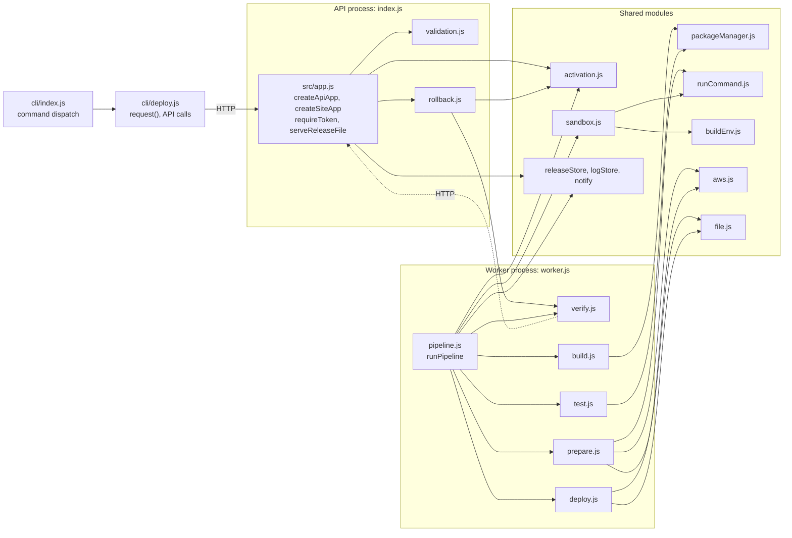

**Reading it.** `src/app.js` never imports its collaborators: `index.js` injects them (`releases`, `logs`, `queue`, `activation`, `rollback`, `storage`), which is why `test/unit/app.test.js` can run the whole API against in-memory fakes with no database, Redis or S3. The worker side has the opposite shape: `pipeline.js` is the single orchestrator that calls the stage modules in order. `verify.js` talks to the API over HTTP (dotted arrow), not by importing it, which makes the check a real network check of the serving code. Not drawn, to keep the picture readable: every module that touches PostgreSQL goes through `db.js` and the three store modules; `rollback.js` also uses `releaseStore.js`/`logStore.js`/`notify.js` and `aws.js`; `app.js` reads artifacts through `aws.js`; and all modules read settings from `config.js`.

### 5.3 Module responsibilities

| Module (path) | Responsibility | Key exports |
|---|---|---|
| `cli/index.js`, `cli/deploy.js` | Parse arguments, call the API, poll a deploy to completion (2 s interval, 30 min cap), print results and readable errors. | `request` (internal), `createRelease`, `getReleaseStatus`, `getAllReleases`, `getReleaseLogs`, `rollbackRelease`, `ApiError` |
| `src/app.js` | HTTP layer. Bearer-token middleware, route handlers, queue-limit check, preview and site file serving with SPA fallback. | `createApiApp`, `createSiteApp`, `requireToken`, `serveReleaseFile` |
| `src/validation.js` | Pure input checks. | `validateRepoUrl`, `isValidReleaseId`, `safeRelativePath` |
| `src/config.js` | Reads and validates environment variables into one `config` object with defaults. | `config` |
| `src/queue.js` | Redis connection and the `deployment-queue` producer. | `connection`, `deployQueue` |
| `worker.js` | BullMQ consumer, concurrency from `config.workerConcurrency`, graceful shutdown. | — |
| `src/pipeline.js` | Orchestrates stages, updates stage/status, writes logs and notifications, cleans up in `finally`. | `runPipeline` |
| `src/prepare.js` | Clean workspace, shallow `git clone` with a clean environment and timeout, commit SHA, source snapshot upload. | `prepareRelease` |
| `src/packageManager.js` | Detect npm/pnpm/yarn, choose reproducible install command, classify the test script. | `detectPackageManager`, `installCommand`, `runScriptCommand`, `classifyTestScript`, `readPackageJson` |
| `src/sandbox.js` | The isolation abstraction: `createSandbox` returns `{exec, disableNetwork, copyOut, destroy}` for Docker mode or an unisolated local mode. | `createSandbox`, `removeOrphanedSandboxes` |
| `src/buildEnv.js` | Allowlisted environment (`PATH`, `HOME`, `TMPDIR`, `CI`, locale) for the local (non-Docker) mode. | `createBuildEnvironment` |
| `src/runCommand.js` | `spawn` wrapper without a shell: timeout, bounded output tail, secret redaction, structured error. | `runCommand`, `runCommandOrThrow`, `redactSecrets`, `CommandError` |
| `src/build.js`, `src/test.js` | Run install + build, and test, through the sandbox; classify tests as PASSED or SKIPPED. | `buildRelease`, `testRelease` |
| `src/deploy.js` | Copy `dist/`, `build/` or `out/` out of the sandbox, validate it, upload it and confirm sizes. | `collectBuildOutput`, `validateArtifact`, `uploadArtifact`, `localAssetReferences`, `artifactPrefix` |
| `src/verify.js` | HTTP checks: candidate via `/preview/{id}/`, live via the site server. | `verifyCandidate`, `verifyActive` |
| `src/activation.js` | The live pointer, with a Postgres advisory lock. | `getActiveReleaseId`, `activateRelease`, `revertActivation` |
| `src/rollback.js` | Validate a rollback target and re-activate it. | `rollbackRelease`, `RollbackError` |
| `src/aws.js` | Thin S3 wrapper (supports custom endpoint for mocks and falls back to the AWS credential chain). | `uploadFile`, `listS3Objects`, `getS3Object`, `isNotFoundError` |
| `src/releaseStore.js`, `src/logStore.js`, `src/notify.js` | SQL for releases, logs (messages capped at 16 KiB), notifications. | `createRelease`, `getRelease`, `updateRelease`, `getAllReleases`, `logRelease`, `getReleaseLogs`, `notifyRelease`, `getReleaseNotifications` |
| `src/db.js`, `src/migrate.js`, `db/schema.sql` | Connection pool; idempotent schema applied at start-up under an advisory lock. | `pool`, `runMigrations` |
| `src/file.js` | Symlink-skipping directory walk; S3 key construction. | `getAllFiles`, `toObjectKey` |
| `src/genrate.js` | 8-character alphanumeric release IDs from `crypto.randomInt` (the file name keeps its historical spelling). | `genrate` |

### 5.4 Data movement and failure propagation

The **release ID** is the single thread through the system. The API generates it (`genrate()`), stores it in `releases.release_id`, and uses it as the BullMQ `jobId`. The worker receives `{releaseId, repoUrl}`; every stage function takes `releaseId`, and results flow forward as plain objects: `prepareRelease → {workspacePath, commitSha}` → `buildRelease → {packageJson, packageManager}` → `testRelease → {testStatus}` → `collectBuildOutput`/`validateArtifact`/`uploadArtifact → {artifactPath}` → `verifyCandidate` → `activateRelease → {previousReleaseId}`.

**Failure is an exception.** Each stage throws an `Error` (command failures are `CommandError`s carrying the captured output). `runPipeline` has one `try/catch`:

1. The catch block logs the last 12,000 characters of command output and the error message at level ERROR (secrets redacted).
2. It marks the release `FAILED` with `current_stage` = the stage that was running and an `error_message`.
3. It writes a `RELEASE_FAILED` notification.
4. It **rethrows**, so BullMQ records the job as failed.
5. `finally` always removes the sandbox container and the workspace directory.

Every one of those secondary steps is individually wrapped so that a failure to *log* or *notify* never replaces the original error **[verified]**. Because ACTIVATE is the last stage and earlier stages never touch the live pointer, any exception before it leaves the previous release live.

### 5.5 Deployment sequence

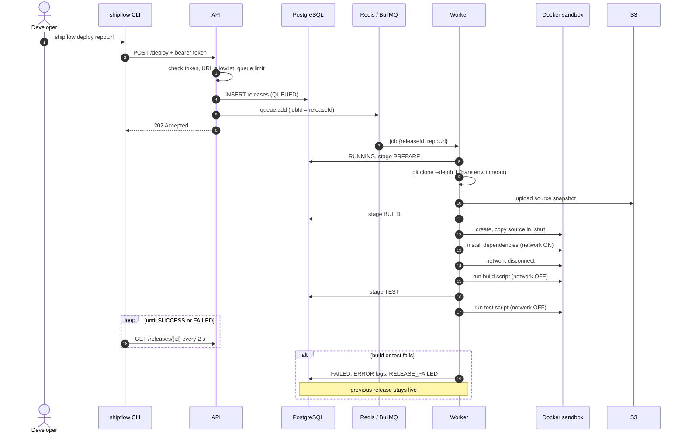

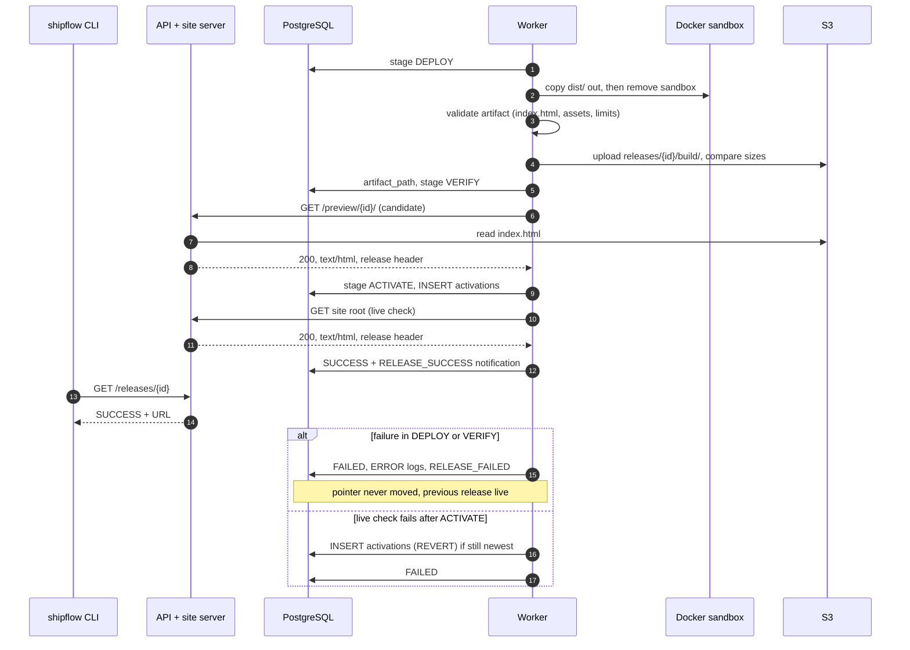

**Walk-through.** Diagram E1 covers the synchronous part and the sandboxed stages. Steps 1–6 are fast: the CLI gets its answer as soon as the row and the job exist. Everything after that runs in the worker while the CLI polls (drawn once as a loop; it actually runs until a terminal state and tolerates up to four consecutive transient API errors). The sandbox exists only between "create" and "copy out"; later stages work on files copied out of the container, with symlinks skipped.

Diagram E2 continues from the finished build. The artifact is validated and uploaded **after** the sandbox is gone. The *candidate* is checked through `/preview/{id}/` while the live pointer still names the previous release. Only then is the pointer moved, followed by a second check of the real site root. The two alternatives match the code: failures before ACTIVATE never touch the pointer; a failed live check inserts a `REVERT` activation (only if nothing newer was activated meanwhile) and then fails the release.

### 5.6 Rollback sequence

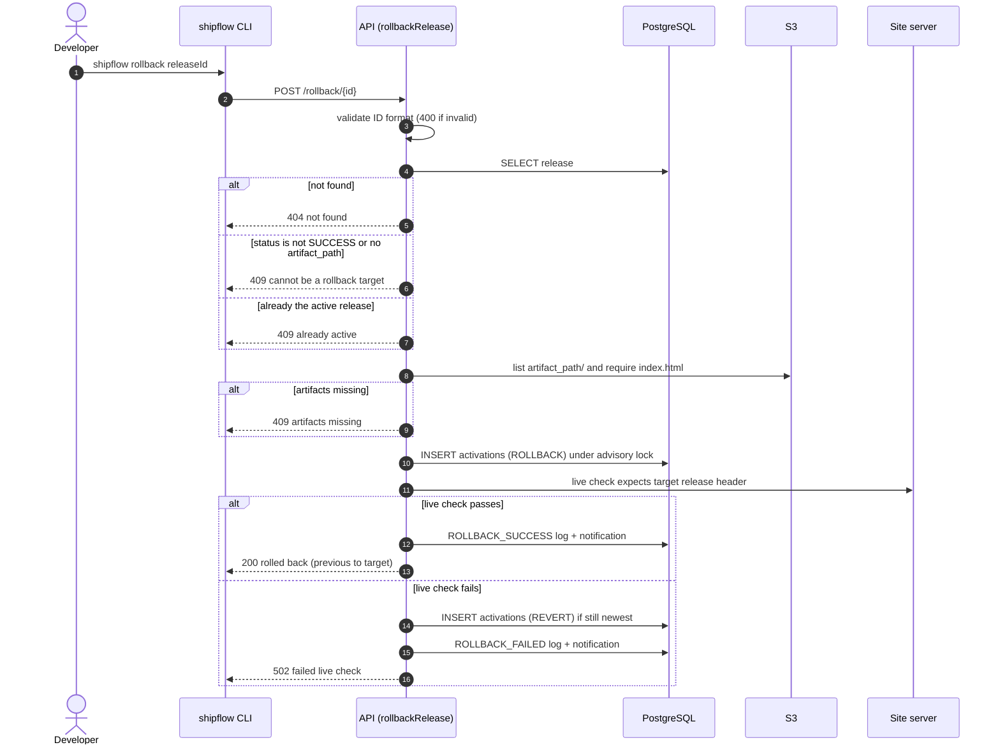

**Does rollback rebuild?** No **[verified]**. `rollbackRelease` never clones or builds; it re-points the live pointer at the *existing* immutable artifact in `releases/{id}/build/`. That is why rollback is fast, why it works even if the source repository changed or disappeared, and why it depends entirely on that artifact still being in S3 (ShipFlow never deletes it, but nothing enforces retention either). The outcome is written to `release_logs` and `notifications` under the *target* release ID, with stage `ROLLBACK`.

### 5.7 Release state machine

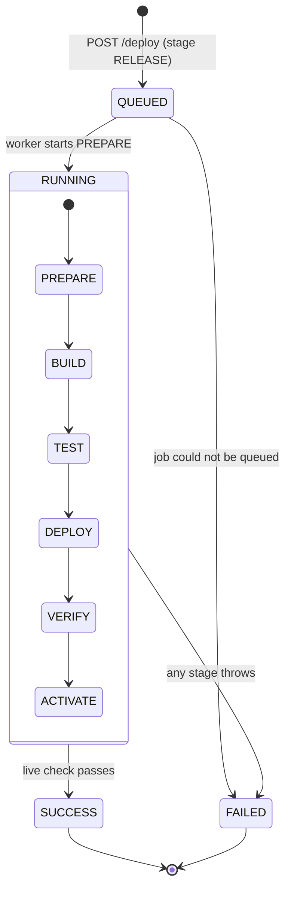

**Status vs stage.** `releases.status` takes four values in code — `QUEUED`, `RUNNING`, `SUCCESS`, `FAILED` — and `releases.current_stage` takes seven: `RELEASE` (initial), `PREPARE`, `BUILD`, `TEST`, `DEPLOY`, `VERIFY`, `ACTIVATE` **[verified]** from `src/app.js` and `src/pipeline.js`. The schema defines both as `VARCHAR` with **no CHECK constraint**, so these sets are enforced by code only. On success the row ends as `SUCCESS` / `ACTIVATE`; on failure as `FAILED` / *the stage that failed*. Older rows from the first implementation end as `SUCCESS` / `VERIFY` because ACTIVATE did not exist then.

**Status is not liveness.** A `SUCCESS` release is not necessarily *live*: liveness is the newest `activations` row. After a rollback, the newer release keeps status `SUCCESS` but is no longer active. The CLI and API expose this as the derived field `is_active`.

## 6. The Final Release Lifecycle, Stage by Stage

All stages are driven by `runPipeline` in `src/pipeline.js`. Entering a stage does two things: `updateRelease` sets `status = RUNNING` and `current_stage`, and a `"<STAGE> stage started"` row is written to `release_logs`. The order below is the order in the code **[verified]**, which differs from the original design in two ways: verification now happens *before* activation, and ACTIVATE is a stage of its own.

### 6.1 PREPARE

* **Input:** `releaseId`, `repoUrl` (already validated by the API).
* **Operation:** delete any previous workspace for this release (so a retried job starts clean), then `git clone --depth 1 --single-branch --no-tags -- <repoUrl> /workspaces/<id>/source` with `-c protocol.file.allow=never`, a 120 s timeout and a minimal environment (`PATH`, a temp `HOME`, `GIT_TERMINAL_PROMPT=0`, `GIT_CONFIG_NOSYSTEM=1`; no credentials). Read the commit SHA with `git rev-parse HEAD`; an empty repository fails here. Walk the tree (skipping `.git`, `node_modules` and all symlinks), enforce the file-count limit (5,000), and upload each file to `releases/<id>/source/…`.
* **Output:** `workspacePath`, `commitSha`, file count.
* **Stored:** `releases.commit_sha`; logs; the source snapshot in S3.
* **Failures:** clone error or timeout, empty repository, too many files, S3 error. **Live site: unchanged.**

### 6.2 BUILD

* **Input:** the cloned workspace.
* **Operation:** read `package.json` (missing file, invalid JSON and a missing `build` script are explicit errors); detect the package manager; create the sandbox container (Diagram C) and copy the source in; run the install command with the network **on** (`npm ci`, `pnpm install --frozen-lockfile`, `yarn install --frozen-lockfile` / `--immutable` when a lockfile exists; non-reproducible fallbacks are logged as such); then `docker network disconnect bridge` and run `npm|pnpm|yarn run build` with the network **off**. Timeouts: 600 s each.
* **Output:** parsed `packageJson` and `packageManager`.
* **Stored:** logs including the install and build output (tail-limited to 64 KiB per command, 16 KiB per log row).
* **Failures:** no `build` script, install failure, build failure, timeout (a timeout removes the whole sandbox, because killing the `docker exec` client does not stop the process inside). **Live site: unchanged.**

### 6.3 TEST

* **Input:** the same sandbox, the parsed `package.json`.
* **Operation:** `classifyTestScript` returns `MISSING`, `PLACEHOLDER` (npm's default `no test specified`) or `PRESENT`. A real script runs with `run test`, network off, 300 s. A missing or placeholder script is recorded as **SKIPPED** with a WARN log, unless `SHIPFLOW_REQUIRE_TESTS=true`, in which case the release fails.
* **Output / stored:** `releases.test_status` = `PASSED` or `SKIPPED`. A failing test throws, so a release can never be `SUCCESS` with failed tests.
* **Why it matters:** the original code either threw on a missing test script or, for a placeholder script, could report "tests completed". Reporting `SKIPPED` honestly distinguishes *"tests ran and passed"* from *"nothing was tested"*.
* **Failures:** test failure, timeout, tests required but absent. **Live site: unchanged.**

### 6.4 DEPLOY (upload a candidate; nothing goes live)

* **Input:** the sandbox with its build output.
* **Operation:** copy the first existing directory of `dist/`, `build/`, `out/` out of the sandbox (`docker cp`), then **destroy the sandbox**. `validateArtifact` requires a non-empty directory, ≤ 5,000 files, ≤ 200 MB, an `index.html` at its root, and that every local `src`/`href` in `index.html` points at a file that exists in the build (this catches the "blank page" class of bug). `uploadArtifact` then uploads every file to `releases/<id>/build/…`, lists the prefix and compares each object's size with the local file.
* **Stored:** `releases.artifact_path = releases/<id>/build`, `deployment_url = /preview/<id>/`.
* **Failures:** no output directory, validation error, S3 error, size mismatch. **Live site: unchanged.** The uploaded objects stay in S3 (there is no garbage collection).

### 6.5 VERIFY (check the candidate)

* **Operation:** the worker requests `GET <INTERNAL_API_URL>/preview/<id>/` with the API token. The API serves the candidate's `index.html` from S3 through the same `serveReleaseFile` code the live site uses. The check requires HTTP 200, a `text/html` content type, and an `X-ShipFlow-Release` header equal to the release ID, with a 10 s timeout and no redirect following.
* **What it proves:** the uploaded artifact is readable from S3 and served correctly by ShipFlow's own server.
* **What it does not prove:** that every asset loads (only `index.html` is fetched; assets are covered by the static reference check in DEPLOY), or that the page *works* in a browser (no JavaScript is executed).
* **Failures:** any of the three checks. **Live site: unchanged.**

### 6.6 ACTIVATE (the only stage that changes what visitors see)

* **Operation:** `activateRelease` opens a transaction, takes `pg_advisory_xact_lock(4242001)`, reads the newest `activations` row (the *previous* release) and inserts `(release_id, previous_release_id, action='DEPLOY')`. Then `verifyActive` requests the **site server's** root up to three times (1 s apart) and expects the same three properties. If that live check fails, `revertActivation` inserts a `REVERT` row pointing back at the previous release — but only if the newest row is still this release. Finally the release becomes `SUCCESS` / `ACTIVATE` and `public_deployment_url` is set from `PUBLIC_SITE_URL`.
* **Failures:** database error (nothing changes), live check failure (reverted, release marked `FAILED`). **Live site: previous release is restored.**

### 6.7 Notifications

`notifyRelease` inserts a row into `notifications` with type `RELEASE_SUCCESS`, `RELEASE_FAILED`, `ROLLBACK_SUCCESS` or `ROLLBACK_FAILED` and prints it to the worker or API log. **A "notification" in ShipFlow today is a persisted record shown by `shipflow logs`; nothing is sent to e-mail, Slack or a webhook.** That is a limitation, and a natural extension point.

### 6.8 Deploying, verifying and activating are three different things

| Concept | Meaning in ShipFlow | Reversible? | Visible to visitors? |
|---|---|---|---|
| **Deploy** (stage DEPLOY) | Bytes validated and stored at the immutable `releases/<id>/build/` prefix. | Harmless: just unused objects. | No |
| **Verify** (stage VERIFY) | An HTTP check that those bytes are served correctly through `/preview/<id>/`. | n/a | No (token required) |
| **Activate** (stage ACTIVATE) | One row inserted into `activations`; the site server now reads this release. | Yes: insert another row (rollback). | **Yes** |

## 7. Database Design

### 7.1 Entity-relationship diagram

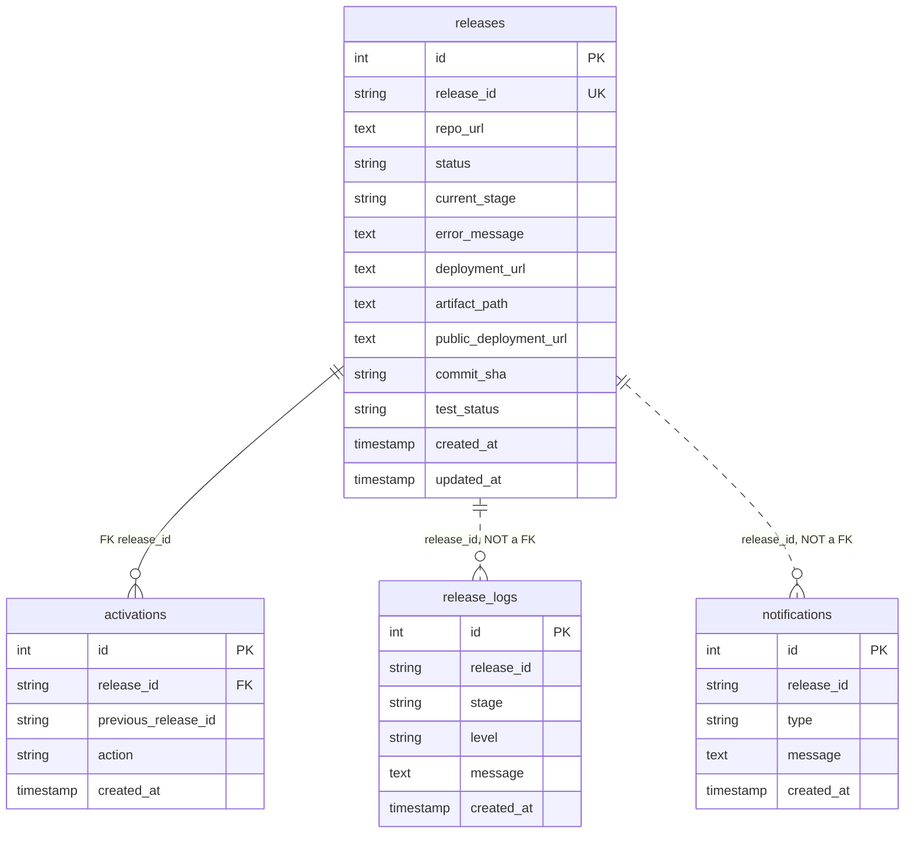

Solid lines are enforced foreign keys; **dotted lines are logical relationships that the database does not enforce**. Types are simplified (`string` is `VARCHAR(n)`).

### 7.2 Tables

| Table | Purpose | Key and constraints | Indexes | Notes |
|---|---|---|---|---|
| `releases` | One row per release request; current status and stage; links to the artifact. | PK `id` (serial); `release_id VARCHAR(20) NOT NULL UNIQUE`; `repo_url`, `status`, `current_stage` NOT NULL. | PK, unique index on `release_id`. | `status`/`current_stage` have **no CHECK constraint**. `updateRelease` uses `COALESCE`, so a column can be *set* but never cleared back to `NULL`. |
| `release_logs` | Ordered stage log lines (INFO / WARN / ERROR), including captured command output. | PK `id`; `release_id`, `stage`, `message` NOT NULL; `level` default `INFO`. | `(release_id, id)`. | **No foreign key** to `releases`: a log can name an unknown release. The API checks existence before serving logs. |
| `notifications` | Success/failure/rollback records. | PK `id`; `release_id`, `type`, `message` NOT NULL. | `(release_id, id)`. | No foreign key, as above. |
| `activations` | **Append-only history of what was live**; newest row wins. | PK `id`; `release_id` → `releases.release_id` (FK); `previous_release_id` plain column; `action` NOT NULL (`DEPLOY`, `ROLLBACK`, `REVERT`). | PK only. | `release_id` is nullable so a revert with no earlier release can leave "nothing active". The table doubles as an audit trail. |

### 7.3 How the system answers its key questions

* **Identify a release:** `releases.release_id`, an 8-character alphanumeric ID (62⁸ ≈ 2.2 × 10¹⁴ values) from `crypto.randomInt`; also the BullMQ `jobId` and part of every S3 key.
* **Track progress:** `releases.status` + `current_stage`; the CLI polls `GET /releases/{id}`.
* **Record what happened:** `release_logs` rows in id order; `notifications` for outcomes.
* **Find the live release:** `SELECT release_id FROM activations ORDER BY id DESC LIMIT 1` (`getActiveReleaseId`).
* **Find a release's files:** `releases.artifact_path`, e.g. `releases/Ab12CdEf/build`.

### 7.4 Illustrative data flow (placeholder values)

| Step | Table | Row written (placeholders) |
|---|---|---|
| `POST /deploy` | `releases` | `Ab12CdEf`, `https://github.com/<user>/<repo>`, `QUEUED`, `RELEASE` |
| Worker runs PREPARE … ACTIVATE | `releases`, `release_logs` | status `RUNNING`, `current_stage` advances; logs such as `PREPARE/INFO "Cloned commit <sha>"` and `BUILD/INFO "Package manager: npm (lockfile found, reproducible install)"` |
| ACTIVATE | `activations` | `release_id = Ab12CdEf`, `previous_release_id = Zz98YxWv`, `action = DEPLOY` |
| Success | `releases`, `notifications` | `SUCCESS` / `ACTIVATE`, `test_status = PASSED`; `RELEASE_SUCCESS "Release Ab12CdEf deployed and verified (tests: PASSED)."` |
| `shipflow rollback Zz98YxWv` | `activations`, `notifications` | `release_id = Zz98YxWv`, `previous_release_id = Ab12CdEf`, `action = ROLLBACK`; `ROLLBACK_SUCCESS` recorded under `Zz98YxWv` |

### 7.5 Migrations

`db/schema.sql` is written to be **idempotent**: `CREATE TABLE IF NOT EXISTS`, `ALTER TABLE … ADD COLUMN IF NOT EXISTS`, `CREATE INDEX IF NOT EXISTS`. `runMigrations` (`src/migrate.js`) runs the file under `pg_advisory_lock(4242000)` so the API and worker cannot race at start-up. This upgraded the pre-existing database in place **[verified]** (35 earlier releases were preserved). It is *not* a versioned migration framework: there is no `schema_migrations` table, and destructive changes (dropping or renaming columns) would need a real tool.

## 8. Engineering Evolution: What Changed, Why, and How

### 8.1 Summary table

| Problem in original implementation | Change implemented | Why it matters | How it works now | Verification |
|---|---|---|---|---|
| Repository scripts inherited the worker's environment (AWS, DB, Redis, API settings) and shared its filesystem. | Disposable Docker sandbox per release; allowlisted environment for the local fallback mode. | Build scripts are untrusted code; a single `postinstall` could exfiltrate every secret. | `src/sandbox.js` creates a container with no ShipFlow env vars, no mounts, no socket; source is copied in and `dist/` copied out. | Probe in e2e [tested]; unit test of env filtering [tested]. |
| No authentication; any URL accepted; unbounded queue. | Bearer token, repository allowlist, ID validation, 10 KB body limit, queue limit. | Prevents arbitrary deployment and uncontrolled build execution. | `requireToken` (constant-time), `validateRepoUrl`, `isValidReleaseId`, `maxQueuedReleases`. | Unit tests (`app.test.js`, `validation.test.js`) and e2e auth scenario [tested]. |
| Delete `active/`, then copy files; verify afterwards. | Immutable `releases/<id>/build/` + `activations` pointer; verify candidate before activating. | Failed or slow releases left the site empty or broken. | Stages DEPLOY → VERIFY → ACTIVATE (Chapter 6). | e2e: failed releases leave the previous site live [tested]. |
| Rollback ignored the chosen target; destructive copy. | Rollback to a named, successful release by moving the pointer. | Predictable, fast, non-destructive recovery. | `rollbackRelease` validates, re-activates, live-checks, reverts on failure, records outcome. | e2e rollback scenarios [tested]. |
| Output buffered by `execFile` (1 MB), no timeouts, output not persisted. | `runCommand` with timeouts and bounded tail; output stored in logs; secrets redacted. | Large or hanging builds should fail with diagnostics, not crash silently. | `src/runCommand.js`; per-stage timeouts in `src/config.js`. | Unit tests: truncation, timeout, redaction [tested]. |
| Symlink-following uploads. | `getAllFiles` skips symlinks. | Prevents uploading worker files via a malicious repo. | `fs.readdir(withFileTypes)` and `isSymbolicLink()`. | Unit test with a symlink to `/etc/passwd` [tested for `validateArtifact`]. |
| No schema; broken scripts; tracked `node_modules`; no tests/CI. | `db/schema.sql`, migrations, rewritten `package.json`/Docker/Compose, `.env.example`, tests, CI workflow. | A new user must be able to clone and run. | `docker compose up -d --build`. | Compose config validated; e2e builds a fresh stack with empty volumes [tested]; CI itself **not run**. |

### 8.2 Security and sandbox isolation

**Before:** `build.js` spawned `npm`/`pnpm`/`yarn` with no `env`, so Node's default applied (inherit everything); `test.js` spread `...process.env`; the compose file mounted `.:/app`, putting `.env` on the filesystem the scripts could read.

**Now (`src/sandbox.js`):** a container created with `--user 1000:1000`, `--cap-drop ALL`, `--security-opt no-new-privileges`, `--memory`/`--memory-swap` 1 GB, `--cpus 1`, `--pids-limit 512`, `--init`, labelled `shipflow.sandbox=<instance>`, with **no volumes, no Docker socket, and only four environment variables**. The worker uses `docker create` → `docker cp` (in) → `docker start` → `docker exec` for each command → `docker cp` (out) → `docker rm -f`. On start-up the worker removes any labelled containers left by a crash. A second mode, `SHIPFLOW_SANDBOX=none`, runs commands directly on the worker with the allowlisted environment from `src/buildEnv.js` and logs a loud warning; it exists for development and is **not isolated** (repository code can still read the worker's files).

| Property | Evidence level |
|---|---|
| No ShipFlow environment variables visible; non-root (uid 1000); internet only during install; internal services unreachable by name | **Tested** (e2e probe, all phases) |
| Capabilities dropped, `no-new-privileges`, memory/CPU/PID limits, no mounts, no socket | **Architectural** — set by `docker create` flags, verified by reading the code, but no test attacks them (no fork-bomb, OOM or escape test) |
| Timeout kills the sandbox | Timeout of `runCommand` is unit-tested; destroying the container on timeout is **not tested** |
| Symlink safety | `validateArtifact` unit-tested; `prepareRelease` uses the same walker but is not separately tested |
| Host ports reachable via bridge gateway during install | **Verified gap** (manual test; not covered by the probe) |

### 8.3 API security

* **Bearer token:** every endpoint except `GET /health` requires `Authorization: Bearer <SHIPFLOW_API_TOKEN>`. Tokens are SHA-256 hashed and compared with `crypto.timingSafeEqual`. The API refuses to start without a token of at least 24 characters. **Limitation:** one shared token, no users, no rotation mechanism other than editing `.env` and restarting.
* **Repository allowlist:** the URL must be `http(s)`, contain no credentials, query or fragment, have exactly two path segments of safe characters (`owner/repo`), and start with one of `SHIPFLOW_ALLOWED_REPO_PREFIXES` (default `https://github.com/`). Git is invoked with `--` before the URL, defeating option injection.
* **Release IDs** must match `^[A-Za-z0-9]{8}$` (enforced by `app.param`); this removes the old path-traversal surface.
* **Limits:** JSON bodies ≤ 10 KB; at most `SHIPFLOW_MAX_QUEUED` (5) waiting/active jobs (`429` beyond that — the check and the enqueue are not one atomic operation, so a burst can slightly exceed the limit **[inferred]**); worker concurrency 1; BullMQ jobs are not retried (default single attempt **[inferred from BullMQ defaults]**).
* **Network exposure:** PostgreSQL and Redis publish no ports. The API and site publish on `127.0.0.1` by default (`API_BIND`/`SITE_BIND`). The site port is unauthenticated by design because it serves public content.
* **Not claimed:** the API is *not* hardened for the public internet (no TLS termination, rate limiting per client, or audit identity).

### 8.4 Build and test reliability

| Change | Why it matters in CI/CD |
|---|---|
| Lockfile-based installs (`npm ci`, `pnpm --frozen-lockfile`, `yarn --frozen-lockfile`/`--immutable`) via Corepack | Reproducible builds: the dependencies you tested are the dependencies you ship. Missing lockfiles are allowed but logged as non-reproducible. |
| Per-command timeouts and a bounded output tail | A hanging or chatty build cannot block the single worker forever or exhaust memory. |
| Output stored in `release_logs`, last 12,000 characters echoed at ERROR on failure | Failure is diagnosable from `shipflow logs` without server access. |
| PASSED vs SKIPPED, optional `SHIPFLOW_REQUIRE_TESTS` | A pipeline that says "success" when nothing was tested gives false confidence. |
| Logging failures never replace the original error | The error you see is the root cause, not a secondary database problem. |
| CLI diagnostics (`Cannot reach ShipFlow API at … (ECONNREFUSED)`, 401 hint about the token, real 404s) | Operability: failures say what to do next. |

### 8.5 Safe artifacts, activation and rollback

**The old behaviour.** Activation was `deleteS3Prefix("active/")` followed by a copy loop. For the duration of that loop — and permanently if it failed half-way — the live prefix was empty or mixed.

**The new behaviour.** Artifacts live at `releases/<id>/build/` and are never modified. "Live" is the newest row in `activations`. The site server resolves the pointer on every request. Activation therefore needs **no S3 writes**, only a PostgreSQL insert.

**The exact scope of atomicity** (be precise in interviews):

* *What is atomic:* the change of the pointer. Within one transaction, under an advisory lock, a single row is inserted; any request that reads the pointer afterwards sees the new release, and any request before sees the old one. Concurrent activations (deploy + rollback, or two workers) are serialised by the lock; the **newest row wins**.
* *What is not atomic:*
  1. **A visitor mid-page-load.** If the HTML came from release A and the browser then requests `/assets/app-<hash>.js` after the switch to B, the file may not exist in B (hashed names differ) and the request returns 404. Cache headers are `no-cache`, so a reload fixes it, but ShipFlow does not keep old assets around. This is a real, un-mitigated race for single-page apps.
  2. **Pointer and status are separate statements.** The `activations` insert commits before `releases.status` becomes `SUCCESS`. A crash in between leaves a live release whose status still says `RUNNING`; nothing reconciles it **[inferred, not tested]**.
  3. **S3 uploads are not atomic** — but that is harmless by design because nothing reads `releases/<id>/build/` until activation.
  4. **Verification is not a lock.** Between the candidate check and activation, S3 could in theory change; in practice artifacts are write-once.
  5. **Revert is conditional.** `revertActivation` only reverts if the newest row is still the one being undone, otherwise it assumes someone else already moved the pointer.
* *Cost of the design:* each page request performs two small queries (`activations` then `releases`) and one S3 `GET`, with no cache or CDN. Fine for a demo, a bottleneck for traffic.

### 8.6 Logging, database and setup

* **Persistent logs/notifications** replace console-only output; `GET /releases/:id/logs` returns both, `404` for an unknown release, and `200` with an empty list for a queued release, which fixes the original ambiguity.
* **Schema and migrations** (Chapter 7), **Compose** with health checks (`pg_isready`, `redis-cli ping`, API `/health`), start order via `depends_on: condition: service_healthy`, named volumes, `restart: unless-stopped`.
* **Credentials and build context:** `.env` is excluded by `.dockerignore` (verified: the built image contains no `.env`) and by `.gitignore`; `.env.example` has placeholders only; the database password is now taken from the environment instead of being hard-coded.
* **Repository hygiene:** `node_modules` untracked (staged removal of 6,638 files; local copy kept), embedded repository `output/peBQy5bb` untracked and its generated clone removed, `output/` ignored, `package.json` cleaned (unused `cors`, `redis`, `simple-git`, and a self-referential `link:` dependency removed).
* **Tests and CI:** see Chapter 10. Nothing has been committed or pushed.

### 8.7 Representative bugs found and fixed

| Bug | Cause | Fix | Consequence if left |
|---|---|---|---|
| Worker crashed on import | `src/test.js` imported `"./buildEnv"` without `.js` (ES modules require the extension). Reproduced: `ERR_MODULE_NOT_FOUND`. | Added extension; rewrote the module graph. | No release could ever run. |
| CLI `logs` hid real errors | Error branch executed `await body.text()` where `body` was being declared (`const body = await body.text()`), a temporal-dead-zone `ReferenceError`. | One shared `request()` helper that reads the response and builds a clear `ApiError`. | The user saw a JavaScript error instead of "Release not found". |
| `npm run build` failed | `scripts.build` was `node build.js`, a file that does not exist. | Replaced with working scripts. | Confusing failure for anyone running the documented script. |
| Rollback chose its own target | `getPreviousSuccessfulRelease(currentReleaseId)` treated the argument as the current release. | Rollback takes the *target*; validates it. | You could not restore a specific known-good release. |
| Real portfolio blank at `/` | The portfolio's `vite.config.js` had `base: "/active/"`; ShipFlow now serves at `/`. The artifact validator rejected the build: *"index.html references files missing from the build: active/assets/…"*. Two attempts (`v7FPJlUQ`, `Tq6KqIwL`) failed at DEPLOY **[verified]** in the database; after the repository set `base: "/"`, release `S0OsNTLV` reached `SUCCESS`/`ACTIVATE` and is what `localhost:8081` serves **[verified]**. | Fixed in the *repository being deployed*, not in ShipFlow; ShipFlow's validator did its job. | A broken page would have gone live. |
| Probe reached the real API | The e2e probe's check for `host.docker.internal:8000` succeeded when the normal stack was running, because that name resolves to the host. `--add-host host.docker.internal:127.0.0.1` was added to the sandbox. | Name blocked; **13/13 e2e pass with the normal API running** **[verified]**. | A sandbox could probe the host's published services by name. The gateway-IP path remains (see Chapter 9). |
| Empty clone passed PREPARE | A first fixture server spoke the "dumb" git protocol, which cannot do shallow clones; a clone of an empty repository exits 0. The failure surfaced later as a confusing *"No package.json"* in BUILD. | PREPARE fails explicitly: *"Repository is empty: no commit to deploy"*; the fixture server now uses `git http-backend`. | Misleading errors far from the cause. |

## 9. Security Model and Threat Analysis

**Scope and trust assumption.** ShipFlow executes code from Git repositories. The *worker, API, database, queue and the person holding the API token* are trusted. *Everything inside a repository* — scripts, dependencies, and the files it builds — is untrusted. The intended deployment is a single owner (or small team) deploying their own repositories.

### 9.1 Threat table

Residual risk is shown for two situations: **demo** (one trusted owner, localhost or private network) and **public** (arbitrary users could submit repositories). It is a judgement based on the evidence in this document, not a measured score.

| # | Threat | Mitigation implemented | Test evidence | Remaining limitation | Residual risk (demo / public) |
|---|---|---|---|---|---|
| 1 | **Malicious `postinstall`** in the repo or any dependency | Runs inside a disposable container: non-root, `--cap-drop ALL`, `no-new-privileges`, no secrets, no mounts, no socket, memory/CPU/PID limits, 600 s timeout. | Probe asserts no sensitive env names, uid 1000, no internal services by name [tested]. | Shares the host kernel (a kernel or runtime exploit is a container escape). Has internet during install, so it can exfiltrate anything inside the sandbox and reach **host-published ports through the bridge gateway** (verified gap). | Low–Med / **High** |
| 2 | **Malicious build or test script** | Same container; network removed before build and test; timeouts. | e2e: build has no internet [tested]. | Same kernel-sharing limit. A malicious build can still emit a hostile **artifact** (e.g. JavaScript) that ShipFlow then serves from its own origin. | Low / **High** |
| 3 | **Credential theft** (AWS, DB, API token) | Environment never inherited: sandbox gets 4 variables; local mode uses an allowlist; `.env` excluded from image and Git; `redactSecrets` masks worker-env secret values in logs; git runs with a bare environment. | Probe + `localSandbox.test.js` [tested]; image has no `.env` [verified]. | If a sandbox escaped, the worker's environment (including AWS keys) is the prize. Long-lived access keys are used today rather than an instance role. `redactSecrets` only knows values present in the *worker's* environment. | Low / High |
| 4 | **Filesystem and symlink attacks** | Symlinks never followed or uploaded; no bind mounts; build output copied out with `docker cp` and re-walked; `safeRelativePath` blocks `..`, encoded traversal and backslashes in the site/preview servers; release IDs validated. | Unit tests for symlink skipping and traversal (`%2e%2e`, `..%2f`) [tested]. | Symlink handling in `prepareRelease` shares the code but has no dedicated test. Behaviour of `docker cp` with symlinks is documented Docker behaviour, not tested here **[inferred]**. | Low / Med |
| 5 | **Reaching internal services** | Sandbox is not on the Compose network; Postgres and Redis have no published ports; API/site published on `127.0.0.1` only; `host.docker.internal` mapped to loopback. | Probe: named services unreachable [tested]; manual 2026-10-10: ShipFlow ports refused on gateway IP. | **Verified gap:** during install the sandbox reached a Postgres published on `0.0.0.0:5432` via `172.17.0.1`. Other LAN hosts and, on EC2, the metadata service (`169.254.169.254`) are reachable during install unless blocked (not tested; IMDSv2 hop limit 1 recommended). | Med / **High** |
| 6 | **CPU, memory, process, output, disk exhaustion** | `--memory 1g`, `--cpus 1`, `--pids-limit 512`; timeouts; output tail 64 KiB; log rows 16 KiB; artifact ≤ 5,000 files / 200 MB; queue limit 5; concurrency 1. | Unit: output truncation and timeout kill [tested]. Limits themselves not attacked. | No disk quota on the container's writable layer; no cap on S3 growth or retention; a fork-bomb/OOM test does not exist. | Low / Med–High |
| 7 | **Dependency supply chain** | Lockfile installs (reproducible); sandbox limits blast radius. | e2e installs from lockfiles (npm/pnpm/yarn classic) [tested]. | Install scripts are not disabled; no audit, provenance or SBOM; a compromised dependency can poison the served artifact. | Med / High |
| 8 | **Queue abuse, API misuse** | Bearer token (constant-time), repository allowlist, URL and ID validation, 10 KB body limit, `429` when 5 jobs are pending, one worker. | Unit + e2e auth, allowlist, validation, queue-full [tested]. | One shared token; no per-client rate limit or brute-force throttling; limit check is not atomic with enqueue **[inferred]**; `/health` is public. | Low / High |
| 9 | **Docker daemon compromise** | The sandbox has no socket. Only the trusted worker has `docker.sock`, and the worker never executes repository code itself. | None (by nature). | `docker.sock` is effectively root on the host: any worker compromise is a host compromise. Mitigations *not implemented*: rootless Docker, a socket proxy with an API allow-list, a dedicated build VM, gVisor or Firecracker. | Med / **High** |
| 10 | **Public-service exposure** | Default bindings are loopback; Compose publishes no database ports; README says to front with a TLS reverse proxy. | None. | No TLS in the app, no WAF/rate-limit, no audit identity. Not deployed publicly, so not validated in that setting. | Low / **High** |
| 11 | **S3 artifact integrity and access** | Private bucket; object sizes compared after upload; artifacts only read through ShipFlow's servers; README documents a least-privilege IAM policy (`ListBucket` + `GetObject`/`PutObject` on `releases/*`, no delete). | Bucket had *Block Public Access* fully on at the start of this pass [verified]. e2e uses an S3 mock, **real S3 only in manual tests**. | "Immutable" is a convention: no S3 Object Lock or versioning, no checksum comparison, anyone with the key can overwrite. The current key's actual IAM scope is unaudited, and that key was exposed in a working session and **must be rotated**. | Med / Med–High |

### 9.2 What the probe does and does not prove

`test/fixtures/templates/probe` runs `probe.js` during install, build and test and records: environment variables whose names start with `AWS_`, `DB_`, `REDIS_`, `SHIPFLOW_`, `S3_`, `PG`, `POSTGRES`, `INTERNAL_`, `PUBLIC_SITE` or `DOCKER_`; whether a few fixed paths (such as `/app/.env`) exist; TCP reachability of a list of internal host names; and whether `registry.npmjs.org` is reachable. Its results are asserted in the e2e test.

It is a **regression check with defined coverage**, not proof of security. Specifically: the path check looks inside a fresh Node container where those paths would not exist anyway (a weak assertion); the host check uses *names*, not the gateway IP; it never attempts a privilege escalation, escape, resource attack, or a connection to a LAN address. "The probe passed" therefore means *these specific leaks did not occur in these runs*.

### 9.3 Honest summary of security posture

* Good for: a trusted single-owner demo on a private machine, including demonstrating the *design* of defence in depth.
* **Not** acceptable yet for: arbitrary public users. Before that, at minimum: remove the worker's direct socket access (rootless Docker or a socket proxy, ideally a separate build host), restrict the install-phase network (egress allow-list or a proxy that only reaches package registries), per-user authentication and rate limiting, TLS, S3 retention and quotas, serve user sites from separate origins, and add resource-attack and escape tests.

## 10. Test Strategy and Verified Results

### 10.1 Commands

```bash
pnpm test        # node --test "test/unit/*.test.js"      (no Docker needed)
pnpm test:e2e    # sh test/e2e/run.sh                      (Docker required; DOCKER=<path> to override)
```

### 10.2 Layers

| Layer | What it contains | Notes |
|---|---|---|
| **Unit** (pure logic) | `validation.test.js` (5), `packageManager.test.js` (6), `runCommand.test.js` (6), `deploy.test.js` (5) | Input validation, lockfile/package-manager rules, bounded output, timeouts, secret redaction, artifact validation, symlink skipping. |
| **Component / integration (no Docker)** | `app.test.js` (15): the real Express apps on ephemeral ports with in-memory fakes. `cli.test.js` (7): the real CLI process against a fake API. `localSandbox.test.js` (7): real `npm install`/`build`/`test` of fixture projects in the unisolated mode. | Auth, 404 vs empty logs, queue limit, path traversal, CLI error messages, PASSED vs SKIPPED, build and test failure output kept. |
| **End-to-end (Docker)** | 13 scenarios in `test/e2e/e2e.test.js`, run by `test/e2e/run.sh` as a separate Compose project (`shipflow-e2e`): real API, worker, PostgreSQL, Redis, Docker sandboxes, an S3 mock (`adobe/s3mock`) and a fixture git server (`git http-backend`), driven through the real CLI. It never loads `.env` and removes only its own volumes. | The scenarios below. |
| **Manual** | Against the real S3 bucket and the normal local stack. | Not automated; results are reproducible by hand (Section 10.4). |

### 10.3 The 13 e2e scenarios

1. **Probe**: no secrets, worker files or internal services visible; uid 1000; internet during install, none during build.
2. **npm site**: queued → built → tested → uploaded → served; checks status, commit SHA, artifact path, `is_active`, ordered stage logs, and the HTML/JS/CSS content types actually served.
3. **pnpm** project with a frozen lockfile. 4. **Yarn (classic)** project with a frozen lockfile.
5. **No tests**: deploys with `test_status = SKIPPED` and a WARN log.
6. **Second version** replaces the first on the live site.
7. **Build failure**: CLI exit 1, stage BUILD, the failing output present in logs, `RELEASE_FAILED` notification, **live site unchanged**.
8. **Test failure**: same, stage TEST.
9. **Broken artifact** (`index.html` references a missing asset): fails in DEPLOY, live site unchanged.
10. **Logs and notifications** through the CLI.
11. **Rollback** restores the earlier content, marks it active, and records `ROLLBACK_SUCCESS`.
12. **Rollback rejections**: failed target, unknown ID, already-active target.
13. **API enforcement**: no token → 401; disallowed repository → 400; invalid ID → 400; unknown release → 404 (status and logs).

### 10.4 Results observed while preparing this document

| Check | Result | Date |
|---|---|---|
| `pnpm test` (current checkout) | **PASS — 51/51** | 2026-10-10 |
| `pnpm test:e2e`, first attempt | Stack started healthy, then the test-runner step died with a WSL/Docker interop error (`UtilAcceptVsock … accept4 failed 110`). **No scenario ran; environment fault, not a test failure.** | 2026-10-10 |
| `pnpm test:e2e`, second attempt, with the normal stack running on port 8000 and the `--add-host` line present | **PASS — 13/13** (≈ 92 s); no containers or sandboxes left behind | 2026-10-10 |
| Real S3 lifecycle (manual): v1 → v2 → failing build (v2 stays live) → rollback to v1 → full restart keeps v1 live | **PASS** (observed earlier in this engagement; DB rows `9pJFBWBf`, `vGLq6Z8n`, `SZO7BZ3C` and `activations` ids 1–3 are consistent with it) | 2026-10-10 |
| Real portfolio repository deployed through the CLI | **PASS** — release `S0OsNTLV`: `SUCCESS` / `ACTIVATE`, tests `PASSED`; `http://localhost:8081/` returned HTTP 200 `text/html` with `X-ShipFlow-Release: S0OsNTLV` and `/assets/…` references. Two earlier attempts failed at DEPLOY (Section 8.7). **Local address only.** | 2026-10-10 |
| Host reachability from a sandbox-like container (manual) | Without `--add-host`: `host.docker.internal:{8000,8081,5432}` reachable. With it: names refused; `172.17.0.1:5432` **reachable**, `:8000` and `:8081` refused. | 2026-10-10 |

### 10.5 What is **not** tested

* GitHub Actions workflow execution (never pushed); a literal fresh clone from GitHub.
* Resource limits under attack (memory/PID/disk/fork bomb), capability and `no-new-privileges` behaviour, destroying the sandbox on timeout, orphan cleanup after a worker crash.
* Concurrent deployments, two workers, an activation race, a worker crash between activation and status update, S3 or database fault injection.
* Yarn Berry (2+); private repositories; very large repositories; real-S3 runs in CI (CI uses the mock).
* TLS, public exposure, load, and long-running behaviour.

## 11. Design Decisions and Trade-offs

Each answer separates what **is implemented** from what would be **future** work.

* **Why a separate worker instead of building inside Express handlers?** *Implemented.* Builds take minutes and use heavy CPU/memory; an HTTP handler would time out behind proxies, lose work on restart and starve other requests. The API stays small and responsive; the worker can be scaled, restarted and given Docker access independently, and the API container does not need `docker.sock`.
* **Why PostgreSQL for release state?** *Implemented.* Releases, logs and activations are relational, must survive restarts, and need transactions and locks (activation). SQL gives "which release is live?" in one query. Trade-off: schema management (Section 7.5); SQLite would be simpler for a single machine but lacks the advisory-lock semantics used here.
* **Why Redis/BullMQ for the queue?** *Implemented.* A purpose-built job queue with persistence, job IDs, concurrency control and stalled-job handling, with little code. Trade-off: another service; a Postgres-backed queue would remove it at the cost of building those features.
* **Why S3?** *Implemented.* Cheap durable storage and natural versioned prefixes; works with any S3-compatible API (the tests use a mock). Trade-off: network latency and per-request cost on every page view because the site server proxies S3 (no CDN); immutability is not enforced by S3.
* **Why build in disposable containers?** *Implemented.* Isolation from secrets and the worker's filesystem, clean reproducible environments, hard resource limits. Trade-off: the worker needs Docker access (largest residual risk); containers share the host kernel. *Future:* gVisor/Firecracker, rootless Docker, a build VM.
* **Why versioned artifacts plus an activation pointer, not delete-and-recopy?** *Implemented.* No window with an empty site; rollback becomes a pointer change; the exact bytes verified are the bytes served. Trade-off: the pointer lives in PostgreSQL and is read on every request; hashed assets from a previous release are unavailable mid-load (Section 8.5).
* **Why CLI-first?** *Implemented.* Fastest way to demonstrate the whole lifecycle, scriptable, nothing to host for a UI. A dashboard or GitHub App could be added on the same API. *Future.*
* **Why static sites only?** *Implemented scope.* A static site is just files: it can be validated, stored immutably, served trivially and rolled back by changing a pointer. Backends add processes, ports, health checks, databases, secrets and traffic shifting — an order of magnitude more design (Chapter 14).
* **Why manual rollback and persisted logs?** *Implemented.* A person decides when to roll back (no heuristic can misfire), and every outcome is recorded, so incidents are debuggable from `shipflow logs`. Automatic rollback was deliberately not added; the only automatic reversal is undoing an activation whose live check failed.
* **How would it scale from one worker to a pool?** *Future, with some groundwork.* Already helpful: BullMQ supports multiple consumers and a concurrency setting; activations are serialised by an advisory lock; S3 and PostgreSQL are shared. Still needed: shared or per-worker workspace handling, a sandbox host per worker with orphan cleanup scoped by instance label (the label exists), backpressure and fairness, a connection-pool review, and observability of queue depth and build times.
* **What changes for multi-project or multi-tenant use?** *Future.* Today there is **one global live site** per installation. Needed: a `projects` concept with a pointer per project and per-project URLs or subdomains; per-user authentication and authorisation; quotas and retention policies; stronger isolation (micro-VMs), egress allow-lists; serving each project from a separate origin; per-tenant secrets and S3 prefixes.

## 12. Comparison with Existing CI/CD and Deployment Platforms

### 12.1 Two different kinds of product

* **CI/CD workflow platforms** (GitHub Actions, GitLab CI/CD, Jenkins) run *your* scripts when something happens (a push, a schedule, a click). They are general-purpose: the same engine builds a mobile app, runs a linter, or deploys to any cloud. They generally do not host your website; your workflow pushes the result somewhere else.
* **Deployment hosting platforms** (Vercel, Netlify) combine build, hosting, CDN and release management in one product, optimised for web front-ends.
* **ShipFlow** sits between the two in scope: it has a narrow, opinionated pipeline (static sites only) *and* its own release registry and serving path, but it is self-hosted and has no CDN, accounts or previews.

**ShipFlow is not a replacement for every existing CI/CD platform.** Its current focus is a self-hosted, CLI-first release and static-site deployment workflow with a persistent release registry, isolated builds, immutable S3 artifacts, activation control and explicit rollback.

Facts about other platforms below come from their official documentation, accessed **2026-10-10**, and are numbered to the references at the end. Where a cell says *not verified*, the official page was not consulted for this document.

### 12.2 Purpose, execution model and flexibility

| Platform | Primary purpose | Where jobs run and who manages it | Workflow flexibility | Git / GitHub integration |
|---|---|---|---|---|
| **GitHub Actions** | Event-driven automation for GitHub repositories, including CI and deployment workflows. | GitHub-hosted runners: "a new virtual machine … per job" (single-CPU runners are containers on shared VMs), maintained by GitHub [2]. Self-hosted runners: machines you deploy and maintain [1]. | Very high: workflows are code in the repository. | Native. |
| **GitLab CI/CD** | Continuous build/test/deploy defined in `.gitlab-ci.yml` with stages and jobs [5]. | GitLab.com provides runners; self-managed GitLab uses runners you register [5]. The Docker executor runs each job in a separate container [6]. | Very high. | Native for GitLab projects (other-forge use *not verified*). |
| **Jenkins** | Extensible automation server; Pipeline models the release process "as code" in a `Jenkinsfile` [7]. | You run the controller and agents; Jenkins advises not running builds on the built-in node [8]. | Very high (declarative or scripted pipelines, plugins). | Via plugins and webhooks (*not verified*). |
| **Vercel** | Build and host front-end applications. | Vercel runs builds in "a secure, isolated virtual environment" [10]. | Moderate: configurable build/install/output commands. | Git push to GitHub, GitLab or Bitbucket triggers builds [10]. |
| **Netlify** | Build and host sites with atomic deploys. | Netlify runs builds (details *not verified* beyond [11]). | Moderate. | Deploys from a Git push, pull request or manual trigger [11]. |
| **ShipFlow** | Self-hosted release pipeline and static-site serving. | **You** run the API, worker and Docker host. | Low by design: fixed six-stage pipeline for npm/pnpm/yarn static builds. | Clones public repositories over HTTPS from an allowlist; **no webhooks yet**. |

### 12.3 Isolation, artifacts, versioning and hosting

| Platform | Build isolation | Artifact handling | Release versioning and rollback | Hosting of the result |
|---|---|---|---|---|
| **GitHub Actions** | Hosted: fresh VM per job [2]. Self-hosted: GitHub states they "do not have guarantees around running in ephemeral clean virtual machines" and "can be persistently compromised by untrusted code", and "should almost never be used for public repositories" [3]. | Workflow artifacts; storage beyond the plan's allowance is billed [4]. | Whatever the workflow implements (tags, environments, re-running an old run). | Not provided; deploy elsewhere (S3, a server, …). |
| **GitLab CI/CD** | Docker executor: separate container per job; privileged mode "exposes the host" [6]. | Job artifacts (*not verified*). | Defined by pipelines (*not verified in detail*). | Not the core purpose. |
| **Jenkins** | Agent model; builds on the built-in node get the controller's file-system access [8]. | Plugins / archived artifacts (*not verified*). | Defined by your pipeline. | Not provided. |
| **Vercel** | Isolated build environment, cleaned up after use [10]. | Uploaded to Vercel's CDN [10]. | **Instant Rollback**: domains are pointed back at a chosen earlier production deployment; Hobby plan: previous deployment only; Pro/Enterprise: any eligible deployment [9]. | Yes (integrated). |
| **Netlify** | *Not verified.* | Deploys are uploaded together; "no changes go live until every file is ready" [11]. | **Atomic deploys**; deploy permalinks are immutable; you can publish a previous deploy [11]. | Yes (integrated). |
| **ShipFlow** | Per-release Docker container, non-root, no secrets, network removed for build/test. **Shared host kernel; worker holds the Docker socket** (Chapter 9). | S3 `releases/<id>/…`; validated before upload. | Immutable prefixes; pointer in PostgreSQL; `shipflow rollback <id>` to any earlier successful release. | Own site server on :8080 reading S3 (no CDN, TLS via an external proxy). |

### 12.4 Security, operations, cost and fit

| Platform | Security responsibility | Operational complexity | Cost model | Best fit |
|---|---|---|---|---|
| **GitHub Actions** | Hosted: GitHub operates the runners. Self-hosted: you [1][3]. | Low (hosted) to medium (self-hosted). | "Free for self-hosted runners and for public repositories" (standard hosted runners); artifact storage over the plan allowance is billed [4]. Private-repo minutes: *see vendor pricing*. | Almost any repository already on GitHub. |
| **GitLab CI/CD** | Vendor for GitLab.com runners; you for self-managed. | Low–high. | *Not verified here.* | Teams on GitLab. |
| **Jenkins** | You (controller, agents, plugins, upgrades). | High. | Software cost *not verified*; you pay for the infrastructure you run it on. | Highly customised or on-premises pipelines. |
| **Vercel** | Vendor for the platform; you for application code and settings. | Low. | Build minutes billed by machine type; Basic is included with Hobby [10]. | Front-end/Next.js apps wanting hosting + CDN + previews. |
| **Netlify** | Vendor. | Low. | *Not verified here.* | Static/JAMstack sites. |
| **ShipFlow** | **You, entirely**: host, Docker, S3, secrets, patching, TLS, backups. | Medium (four services plus S3). | Your infrastructure plus S3 (Chapter 13). | Learning, demonstration, a trusted single-owner static site on your own hardware. |

### 12.5 Interview questions about the comparison

**Why would someone choose ShipFlow instead of GitHub Actions?** For most real projects they should not: GitHub Actions is more flexible, widely supported and free for public repositories [4]. ShipFlow is justified when you *want* the pipeline on your own infrastructure with a built-in release registry and pointer-based rollback, when you want to understand and control every stage, or as an educational/portfolio project.

**Why not Actions with S3 directly?** You can, and for many sites that is the better answer: a workflow builds, runs `aws s3 sync`, and optionally invalidates a CDN. What that simple workflow does not give you for free is a **queryable release history, immutable per-release prefixes with a switchable live pointer, candidate verification before go-live, stored stage logs and notifications, a rollback command, and PASSED-vs-SKIPPED test reporting**. Each of those *can* be built into a workflow; ShipFlow packages them as a product with a specific design.

**How is it different from Vercel?** Vercel integrates builds, a global CDN, preview deployments, domains and a dashboard, and manages isolation for you [9][10]. ShipFlow only builds and serves one static site from S3 through a single Node server, with no CDN, previews, domains, accounts or UI.

**Could ShipFlow use GitHub Actions as its trigger or orchestrator?** *Future; not implemented.* A workflow step could call `POST /deploy` with the token stored as a GitHub secret, or GitHub could deliver a webhook to a small receiver. That would need the API to be reachable (HTTPS, public or tunnelled), which in turn raises the exposure risks in Chapter 9.

**What would a simple Actions workflow still have to implement?** See the list above: release registry, pointer activation and rollback, candidate verification, retained logs and notifications, test classification, and — if it runs untrusted pull requests on self-hosted runners — the isolation GitHub warns about [3].

**Is ShipFlow cheaper?** Not by default. Public-repository Actions usage and self-hosted runner minutes are free [4]; ShipFlow needs an always-on host, S3, and maintenance time. It is only cost-competitive if you already own spare capacity, and that is not demonstrated here.

**Is it more secure?** No claim is made. GitHub-hosted runners are fresh VMs [2], a stronger boundary than a container on a shared kernel. ShipFlow's sandbox adds useful controls (no secrets, no network during build), but it also has the Docker-socket exposure and the install-phase network gap described in Chapter 9.

**What are the disadvantages of self-hosting?** You own availability, security patches, backups, capacity planning, monitoring and incident response; idle servers cost money; and your isolation is only as good as your configuration.

**Why static sites only?** A static site is a directory of files, which makes it simple to validate, store immutably, serve and roll back. Backends require runtime orchestration (Section 11).

**What must change for arbitrary backend applications?** Build and store *container images* (registry), run them (orchestration, ports, restart policy), health checks and traffic shifting (rolling or blue/green), secrets and environment management, database migrations and their rollback implications, ingress/TLS routing, logs and metrics, per-app resource quotas — and a much stronger isolation story, because you would be *running* untrusted code, not just building it. *All future.*

## 13. Cost and Operating Model

ShipFlow is **self-hosted**: you pay for the machines instead of a vendor's minutes. No prices are quoted here because none were verified against a current price list for a specific region; the cost *drivers* are:

| Component | What drives cost | Notes |
|---|---|---|
| Compute (API, worker, Postgres, Redis) | Always-on VM or server. | The API and worker are light when idle; builds spike CPU and memory (sandbox default 1 vCPU, 1 GB). |
| Build capacity | Concurrency × per-build resources × duration. | `SHIPFLOW_WORKER_CONCURRENCY` (default 1), sandbox limits and timeouts bound it. |
| Amazon S3 | Storage, requests (PUT/GET/LIST) and data transfer out [12]. | ShipFlow uploads a source snapshot *and* the build output for every release, lists the artifact prefix for verification, and — because the site server proxies S3 — issues a `GET` per asset request. Nothing is ever deleted. |
| Data transfer | Visitors downloading assets through the site server. | No CDN, so every request goes to S3 via your server. |
| Logging and monitoring | Currently only PostgreSQL rows and container logs. | No metrics or alerting stack is included. |
| Domain and TLS | Domain registration; certificates (e.g. via a reverse proxy). | Not configured; ShipFlow is local-only today. |
| Database and Redis | Part of the same host, or managed services. | Compose volumes hold the data; backups are your responsibility. |
| People | Patching, upgrades, security, on-call. | Often the largest real cost of self-hosting. |

**Who pays for compute?** With a managed CI service, the vendor runs builds and bills minutes (or provides free allowances) [4][10]. With ShipFlow, **you** pay for the host whether or not builds run, but there are no per-minute fees. GitHub, for example, does not charge Actions minutes for self-hosted runners [4], which makes "cheaper than Actions" hard to claim.

**Cost controls that exist:** one worker by default, per-stage timeouts, sandbox memory/CPU/PID limits, artifact limits (5,000 files, 200 MB), queue limit of 5. **Controls that do not exist yet:** retention or garbage collection of old releases and source snapshots, per-user quotas, and S3 lifecycle rules.

## 14. Future Scope and Roadmap

*Everything in this chapter is future work, not implemented.*

### 14.1 Near term: a reliable demo

* Finish repository hygiene, commit the work, and run CI on GitHub (the workflow has never executed).
* Verify a literal fresh-clone installation from GitHub.
* Rotate the exposed AWS key; create a bucket-limited IAM identity or use an instance role.
* Close the install-phase host-reachability gap (for example run sandboxes on an isolated Docker network with an egress rule, or a registry-only proxy).
* Deploy API and worker to a controlled server with an HTTPS reverse proxy; only then publish a demo URL.

### 14.2 Medium term

* Projects: per-project configuration, pointer and URL/subdomain.
* GitHub webhook or Actions trigger, with signature verification.
* Richer release history in the CLI; health checks beyond `index.html`; metrics and alerts; notification delivery (webhook/Slack/e-mail).
* Keep previous assets available during a switch (fixes the mid-load 404 race) and make status update part of the activation transaction.
* Retention policies, S3 lifecycle rules and quotas; safe retries; worker pool with backpressure.

### 14.3 Longer term

* Container-image and backend deployments; preview deployments; deployment policies.
* Multiple users with roles; separate origins per project; stronger isolation (rootless Docker, gVisor, Firecracker).
* Additional artifact backends; optional managed SaaS mode with quotas and billing.

## 15. Interview Preparation

> **Rule for yourself:** say *"implemented and tested"*, *"implemented but not tested"* and *"future work"* explicitly. Interviewers trust candidates who know the edges of their own system.

### 15.1 The two-minute explanation

"ShipFlow is a self-hosted, CLI-first CI/CD tool I built for static sites. You run `shipflow deploy <repo url>`. The CLI calls an Express API with a bearer token; the API validates the URL against an allowlist, writes a release row in PostgreSQL and puts a job on a Redis/BullMQ queue, then returns right away so the request never waits for a build.

"A separate worker picks up the job and runs six stages: prepare, build, test, deploy, verify and activate. The interesting part is that repository code is untrusted, so installs, builds and tests run in a disposable Docker container with no secrets, no mounts and no Docker socket, running as a non-root user with dropped capabilities and resource limits; the network is cut after dependencies install. The build output is validated, uploaded to an immutable, versioned S3 prefix, and checked over HTTP *before* it goes live. Going live is a single database insert into an activations table, so the site is never half-updated, and rollback is just another insert pointing at an older artifact.

"I found the original version deleted the live files before the new ones were ready and leaked the worker's environment to build scripts, and fixed both. It's covered by 51 unit tests and a 13-scenario Docker end-to-end suite, including a probe that tries to steal secrets from inside a build. It runs locally; it isn't deployed publicly, and I can tell you exactly what remains before it could take untrusted users — mainly the worker's Docker access and install-time networking."

### 15.2 Architecture walkthrough: one release from CLI to live site

1. `shipflow deploy <url>` sends `POST /deploy` with `Authorization: Bearer <token>` (`cli/deploy.js`).
2. The API checks the token (constant-time), validates the URL (https, `owner/repo`, allowlisted prefix), and checks the queue isn't full (`src/app.js`).
3. It generates an 8-character ID, inserts a `releases` row (`QUEUED`/`RELEASE`), adds a BullMQ job with that ID, and returns `202`.
4. The CLI polls `GET /releases/{id}` every 2 seconds and prints stage changes.
5. The worker takes the job and calls `runPipeline`. **PREPARE:** shallow clone with a bare environment, record the commit, upload a source snapshot.
6. **BUILD:** create a sandbox container, copy the source in, detect the package manager, install from the lockfile with network on, disconnect the network, run the build.
7. **TEST:** run the test script with no network; record `PASSED` or `SKIPPED`.
8. **DEPLOY:** copy `dist/` out, destroy the sandbox, validate (index.html, referenced assets, size limits), upload to `releases/<id>/build/` and confirm sizes.
9. **VERIFY:** `GET /preview/<id>/` with the token must return 200, `text/html` and the right release header.
10. **ACTIVATE:** insert into `activations` under an advisory lock, then check the live site; revert on failure.
11. Mark `SUCCESS`, write a notification; the CLI prints the URL.
12. Visitors hit port 8080: the site server reads the newest activation, looks up its artifact path, streams the file from S3.
13. `shipflow rollback <id>` validates the target and inserts another activation — no rebuild.

### 15.3 Important questions and answers

**System design**

1. **Why is the API separate from the worker?** Builds are long and heavy; the API must stay responsive and does not need Docker access. They scale and restart independently. *(Implemented.)*
2. **Why a queue at all?** To return `202` immediately and run work asynchronously with persistence, concurrency control and failure tracking. Without it, a restart loses the in-flight request and proxies time out.
3. **PostgreSQL vs Redis: why both?** Redis/BullMQ holds *pending work* (ephemeral); PostgreSQL holds *history and the live pointer* (durable, transactional). Losing Redis loses queued jobs but not what happened or what is live.
4. **What does the API return for a deploy, and how does the CLI know it finished?** `202` with the release; the CLI polls status until `SUCCESS` or `FAILED` (30-minute cap). Polling is simple and stateless; websockets or webhooks would be a refinement.

**Queue, worker and failure handling**

5. **What happens if a build fails?** The stage throws; `runPipeline` logs the output tail, sets `FAILED` with the stage and error, writes `RELEASE_FAILED`, rethrows so BullMQ marks the job failed, and always removes the sandbox and workspace. The live site is unaffected because only ACTIVATE changes it. *(Tested in e2e.)*
6. **What if the worker crashes mid-build?** The sandbox container might be orphaned: the worker removes labelled containers at start-up. BullMQ's stalled-job handling may re-run the job; the pipeline starts from a clean workspace and writes to the same S3 keys. *(Cleanup implemented; crash recovery not tested; BullMQ behaviour inferred.)*
7. **Are jobs retried?** No (default single attempt, inferred); a failed release must be redeployed. Safe automatic retries are future work because builds have side effects (S3 uploads).
8. **How do you stop someone queueing hundreds of builds?** Token auth, allowlist, `429` at 5 pending jobs, concurrency 1. Not per-client rate limiting.

**Database consistency**

9. **How do you guarantee only one active release?** "Active" is the newest row in `activations`; there is no flag to get out of sync. Inserts happen in a transaction under an advisory lock, so concurrent activations are serialised and the newest wins.
10. **Is activation atomic?** The pointer change is. The surrounding workflow isn't: release status is updated in a separate statement, and visitors mid-page-load can hit assets from the old version (Section 8.5).

**Isolation and secrets**

11. **How do secrets stay away from repository code?** Never inherited: the sandbox container is created with four variables and no mounts; git runs with a bare environment; `.env` isn't in the image; logs are redacted. The e2e probe asserts no sensitive variable names are visible.
12. **Why not just `{...process.env}` minus the secrets?** A deny-list misses new secrets; an allowlist fails safe. And an environment filter is insufficient alone: shared filesystem or process namespace would still expose data — hence the container.
13. **Why copy files with `docker cp` instead of bind mounts?** A bind mount gives the container a live window onto a host directory (and symlink tricks); copying in and out keeps the boundary explicit. *(Implemented.)*

**Docker networking**

14. **What network does the sandbox have?** Docker's default bridge, not the Compose network, so `postgres`, `redis`, `api` aren't reachable by name. During install it has internet; then `docker network disconnect` removes it for build and test. *(Tested, with the gateway-IP caveat.)*

**S3, verification, rollback**

15. **Why immutable per-release prefixes?** They make activation and rollback cheap and safe and ensure you verify the bytes that will be served. Immutability is by convention only (no Object Lock).
16. **What does VERIFY actually check?** That `/preview/<id>/` returns 200, HTML, with the right release header — i.e. the uploaded artifact is readable and served by ShipFlow's code. It does not run the page in a browser.
17. **How does rollback work and what does it depend on?** Validate target (exists, `SUCCESS`, has artifact, not already active, `index.html` still in S3), insert a `ROLLBACK` activation, live-check, revert on failure, record outcome. No rebuild. Depends on the artifact remaining in S3 and the database being up.

**Security trade-offs, scalability, comparison, evidence**

18. **What is the weakest part of your security design?** The worker's Docker socket: it is effectively host root, and the sandbox shares the host kernel. Next: install-phase network access (including host-published ports via the bridge gateway, which I verified) and a single shared token.
19. **How would you scale to many workers?** Add workers (BullMQ supports multiple consumers; activation is already serialised), give each a sandbox host, ensure orphan cleanup is per-instance, add backpressure and metrics. Multi-tenant needs projects, per-project pointers, auth and quotas. *(Future.)*
20. **How do you know it works?** 51 unit tests and 13 e2e scenarios (re-run on the current checkout: 51/51 and 13/13), plus manual runs against real S3 and a real portfolio. The CI workflow exists but has not run on GitHub.
21. **What did you find wrong in the original design?** Unauthenticated API; the worker's environment leaked to build scripts; delete-then-copy activation with verification after the fact; symlink-following uploads; rollback ignoring its target; no schema; broken CLI error path. I can show the commit history and the fixes.
22. **Why not use GitHub Actions?** Section 12: for most projects you should. ShipFlow's reason to exist is control, learning, and a specific release/rollback model.

### 15.4 Difficult interviewer questions

**"Your worker has access to the Docker socket. Isn't that dangerous?"** Yes — it is root-equivalent on the host. I limited it to the worker (the API has none), the worker never runs repository code itself, and the sandbox gets no socket. But a compromise of the worker is a host compromise. To go public I would use rootless Docker or a socket proxy with an allow-list, or move builds to a separate disposable VM, and consider gVisor or Firecracker. *(Not implemented.)*

**"How can a malicious package install script attack the host?"** It runs in the container with internet access. It cannot read the worker's environment or files (none are mounted) or use the Docker socket. It *can* try to exploit a kernel or runtime vulnerability to escape (shared kernel), consume resources (limited, though disk isn't), poison the artifact, and — which I verified — connect to host ports published on all interfaces through the bridge gateway (it reached a Postgres on `0.0.0.0:5432`; ShipFlow's own loopback-bound ports were refused). On a cloud VM it could also try the metadata service.

**"Is disconnecting the sandbox network sufficient?"** No. It removes network for the build and test phases, which blocks exfiltration and lateral movement during those scripts, but the install phase (where `postinstall` runs) still has network, and it does nothing against kernel exploits or resource abuse. It is one layer.

**"What happens if the S3 upload succeeds but database activation fails?"** The new release never becomes live; the previous one keeps serving. The pipeline marks the release `FAILED` (if the database is reachable) and the uploaded objects remain as unreferenced files — there is no garbage collection. If the database is entirely down, the status update fails too and the release may stay `RUNNING` *(inferred)*.

**"How do concurrent deployments behave?"** With the default concurrency of 1, builds run one at a time. With more workers, builds run in parallel but activation is serialised by a PostgreSQL advisory lock and the newest activation wins. A release that was superseded during its live check may fail that check and, because it is no longer the newest, is not reverted. *(Reasoned from the code; not tested.)*

**"Can you guarantee rollback always works?"** No. It requires the target's artifacts to still be in S3 (nothing enforces retention), PostgreSQL to be reachable, and the post-switch live check to pass; otherwise it returns a clear error and reverts. Happy path and the rejection paths are tested; storage-failure paths are not.

**"How would you make artifact publication atomic?"** The pointer switch is already one atomic insert. The remaining non-atomicity is the visitor's in-flight page load and the status update. I would keep the previous release's hashed assets reachable for a grace period (or serve a union), and update `releases.status` inside the activation transaction. With a CDN, I would switch the origin path or alias in one operation.

**"What if a release succeeds but the database update fails?"** Activation commits first, then status is updated separately. A crash in between leaves a live release with status `RUNNING`. Nothing reconciles that today. The fix is to move the status update into the same transaction, or to add a startup reconciliation pass. *(Known gap.)*

**"Why should anyone choose ShipFlow instead of GitHub Actions?"** Usually they shouldn't. It is useful if you want a self-hosted pipeline with a built-in release registry, verified activation and rollback, and want to understand the machinery — or as a teaching project, which is how I use it.

**"What evidence supports your security claims?"** Specific, limited: an e2e probe that checks environment names, a few paths, internal host names and network state in each phase; unit tests for input validation, traversal, symlinks, redaction and output limits; and code review of the `docker create` flags. I have not attacked the resource limits, capabilities or isolation boundary, so I describe those as *architectural safeguards*, not tested guarantees.

**"Is the application actually running in a public cloud yet?"** No. The compute — API, worker, PostgreSQL, Redis, sandboxes — runs locally on my machine in Docker Desktop. The artifacts are stored in a real AWS S3 bucket, and the site is served at `localhost:8081`. There is no public URL.

## 16. Conclusion and Honest Limitations

ShipFlow began as a sound idea with fragile details: a queue and worker that ran untrusted code with the worker's secrets, and a deployment that deleted the live site before the replacement was ready. The engineering work turned it into a system with a clear trust boundary, immutable artifacts, verified activation and a one-command rollback, and backed it with tests that exercise the real stack. The most valuable lessons are the ones the tests found — a probe that reached the host, an empty clone that passed, a validator that caught a broken base path.

### 16.1 Verified during preparation of this document

* The repository history, the original code at commit `3709133`, and the current source, schema, Compose files, tests and CI workflow were read directly.
* `pnpm test`: 51/51 passed; `pnpm test:e2e`: 13/13 passed (after one environment-caused abort).
* Database contents: release `S0OsNTLV` is `SUCCESS`/`ACTIVATE` and is the newest activation; the live site returned HTTP 200 `text/html` with the matching release header at `http://localhost:8081/`.
* Host reachability from a sandbox-like container with and without `--add-host`.
* Official-documentation statements about other platforms (Section 12, references).

### 16.2 Not verified

* GitHub Actions run; fresh clone from GitHub; behaviour in any public or cloud deployment.
* Resource-limit, capability and escape resistance; metadata-service exposure on EC2.
* Activation races, multi-worker behaviour, crash recovery, S3/DB fault handling.
* The exact IAM permissions of the key in use (and that key needs rotation).
* Claims about GitLab, Jenkins and Netlify beyond the cited pages (pricing and some feature details).

### 16.3 Limitations that must stay in this report

Worker holds the Docker socket · sandbox shares the host kernel · install-phase network can reach host-published ports and the internet · single shared API token · one global live site · no CDN/TLS in the application · no retention or quotas · mid-load asset race on switch · status/pointer reconciliation gap · notifications are records, not messages · not deployed publicly · not suitable for arbitrary public users.

## Appendix A. Glossary

| Term | Meaning |
|---|---|
| **Activation** | Making a release the live one; here, inserting a row into `activations`. |
| **Advisory lock** | A PostgreSQL application-level lock (`pg_advisory_xact_lock`) used to serialise activations and migrations. |
| **Artifact** | The built output of a release (files from `dist/`, `build/` or `out/`). |
| **BullMQ** | A Node.js job-queue library built on Redis. |
| **Bearer token** | A secret sent in the `Authorization: Bearer …` header to authenticate API calls. |
| **Bridge network** | Docker's default container network, NATed through the host. |
| **Candidate** | A release whose artifact is uploaded but not yet active. |
| **Capabilities (Linux)** | Fine-grained root privileges; `--cap-drop ALL` removes them from the container. |
| **CDN** | Content delivery network; caches content near visitors. ShipFlow has none. |
| **CI/CD** | Continuous integration / continuous delivery (or deployment). |
| **CLI** | Command-line interface (`shipflow`). |
| **Compose** | Docker Compose, a tool for defining multi-container applications. |
| **Corepack** | Node tool that runs the package-manager version a project pins. |
| **Docker socket** | `/var/run/docker.sock`; control channel for the Docker daemon, root-equivalent on the host. |
| **E2E** | End-to-end test of the whole system. |
| **ER diagram** | Entity-relationship diagram of database tables. |
| **HLD / LLD** | High-level design (architecture) / low-level design (modules). |
| **Idempotent** | Safe to run repeatedly with the same result (the schema script). |
| **Immutable** | Never modified after creation (release artifacts, by convention). |
| **Lockfile** | File recording exact dependency versions (`package-lock.json`, `pnpm-lock.yaml`, `yarn.lock`). |
| **Pointer** | The "newest activation row" that selects the live release. |
| **Probe** | The test project that tries to leak secrets or reach internal services. |
| **Release** | One deployment attempt, identified by an 8-character ID. |
| **Rollback** | Making an earlier successful release live again. |
| **Sandbox** | The disposable container where repository code runs. |
| **SPA** | Single-page application; unknown paths fall back to `index.html`. |
| **Supply-chain attack** | Compromising software through its dependencies or build tooling. |
| **Trust boundary** | A line between trusted ShipFlow code and untrusted repository code. |

## Appendix B. References

All accessed **2026-10-10**. Statements about these platforms are as summarised from the pages on that date; vendors change documentation and pricing.

1. GitHub Docs — *Self-hosted runners*. https://docs.github.com/en/actions/concepts/runners/self-hosted-runners
2. GitHub Docs — *GitHub-hosted runners*. https://docs.github.com/en/actions/concepts/runners/github-hosted-runners
3. GitHub Docs — *Secure use reference* (Actions). https://docs.github.com/en/actions/reference/security/secure-use
4. GitHub Docs — *GitHub Actions billing*. https://docs.github.com/en/billing/concepts/product-billing/github-actions
5. GitLab Docs — *GitLab CI/CD*. https://docs.gitlab.com/ci/
6. GitLab Docs — *The Docker executor*. https://docs.gitlab.com/runner/executors/docker/
7. Jenkins — *Pipeline*. https://www.jenkins.io/doc/book/pipeline/
8. Jenkins — *Controller isolation*. https://www.jenkins.io/doc/book/security/controller-isolation/
9. Vercel Docs — *Instant Rollback* (page last updated 2026-07-07). https://vercel.com/docs/instant-rollback
10. Vercel Docs — *Builds* (page last updated 2026-09-03). https://vercel.com/docs/builds
11. Netlify Docs — *Deploys overview*. https://docs.netlify.com/site-deploys/overview/
12. Amazon Web Services — *Amazon S3 pricing*. https://aws.amazon.com/s3/pricing/
